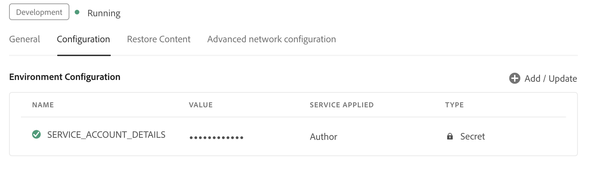

# Configuration de l’assistant AI en mode Agence pour Cloud Service

En tant qu’administrateur, vous pouvez configurer l’assistant AI en mode Agence pour votre organisation dans Experience Manager Guides. Les étapes de configuration varient selon que le paramètre Unified Shell est activé dans votre environnement AEM as a Cloud Service et que les utilisateurs sont connectés via l’authentification SSO ou non. Cet article décrit le processus de configuration pour chaque scénario.

## Prérequis

Votre organisation doit être intégrée à **&#x200B;**&#x200B;avant de configurer l’assistant AI en mode Agentic.

## Configuration de l’assistant d’IA en fonction de votre environnement

Utilisez le tableau suivant pour identifier le chemin de configuration qui s’applique à vos utilisateurs, puis suivez les étapes correspondantes.

| Shell unifié | Type de connexion | Configuration requise |
|---|---|---|
| Activé | SSO | Aucune configuration supplémentaire. Tout est prêt à l’emploi |
| Activé | Non-SSO | Ajouter la configuration IMS à l’environnement |
| Désactivé | SSO | Ajouter la configuration IMS à l’environnement |
| Désactivé | Non-SSO | Ajouter la configuration IMS à l’environnement |

### Utilisateurs avec Unified shell activé

**Connexion SSO**

Si Unified shell est activé et que vos utilisateurs se connectent via SSO, aucune configuration supplémentaire n’est requise. L’assistant AI en mode Agence fonctionne automatiquement une fois que votre entreprise a intégré CX Enterprise Coworker.

**Connexion sans authentification unique**

Si Unified shell est activé mais que vos utilisateurs se connectent sans SSO, vous devez [Ajouter la configuration IMS à l’environnement](#add-ims-configuration-to-the-environment) ci-dessous.

### Utilisateurs avec Unified shell désactivé

Si Unified Shell est désactivé, vous devez [Ajouter la configuration IMS à l’environnement](#add-ims-configuration-to-the-environment) pour les deux :

- Connexion SSO
- Connexion sans authentification unique

## Ajouter la configuration IMS à l’environnement

Pour ajouter la configuration IMS à l’environnement, procédez comme suit :

1. Ouvrez Experience Manager, puis sélectionnez votre programme contenant l’environnement à configurer.

2. Passez à l’onglet **Environnements**.

3. Sélectionnez le nom de l’environnement à configurer. Vous accédez alors à la page **Informations sur l’environnement**.

4. Passez à l’onglet **Configuration**.

5. Collez les détails du service JSON (téléchargés lorsque vous avez créé la configuration IMS dans Adobe Developer Console) dans le champ **Valeur** correspondant à `SERVICE_ACCOUNT_DETAILS`. Veillez à utiliser le même nom et la même configuration que ceux attendus par l’environnement.

>[!NOTE]
>Si vous n’avez pas encore créé les informations d’identification OAuth/IMS pour votre environnement, commencez par le faire dans Adobe Developer Console avant de terminer cette étape.

{width="800"}

## Activation du mode Agent

Une fois la configuration de votre environnement terminée, contactez l’équipe du succès client pour activer le mode Agent.

Lorsque le mode Agentic est activé pour votre environnement, accédez aux paramètres de **&#x200B;**&#x200B;puis activez le bouton bascule **Agentic** sous l’onglet **Général** de la section **Assistant IA**.
