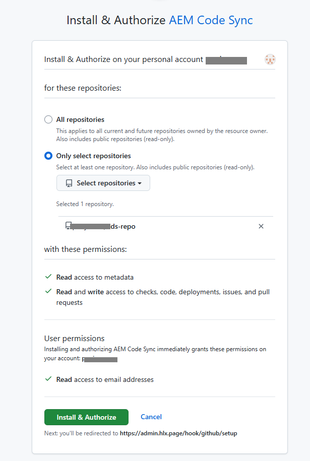
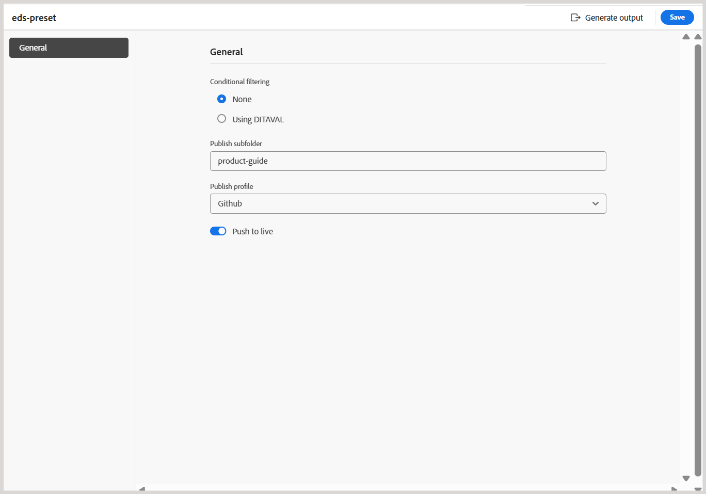

# Experience Manager Guides et Edge Delivery Services

Adobe Experience Manager Guides vous permet de publier votre contenu DITA directement dans Edge Delivery Services (EDS) par le biais d’un profil de publication GitHub dédié. Cette fonctionnalité permet aux entreprises de fournir des expériences de documentation réactives et haute performance tout en conservant des workflows de création basés sur DITA dans Experience Manager Guides.

Pour plus d’informations sur l’utilisation d’EDS dans Adobe Experience Manager, consultez la [Présentation de Edge Delivery Services](https://experienceleague.adobe.com/fr/docs/experience-manager-cloud-service/content/edge-delivery/overview).

Pour activer la publication de Experience Manager Guides vers EDS, vous devez effectuer une série d’étapes de configuration sur GitHub et Experience Manager Guides. Les sections ci-dessous décrivent chaque étape dans l’ordre et expliquent comment elles fonctionnent ensemble dans le workflow de publication global.

1. [Installer et configurer GitHub pour EDS](#set-up-and-configure-github-for-eds)
2. [Création et configuration d’un profil de publication pour EDS dans Experience Manager Guides](#create-and-configure-a-publish-profile-for-eds-in-experience-manager)
3. [Personnaliser la sortie à l’aide de blocs EDS](#customize-output-using-eds-blocks)

Pour une présentation vidéo rapide, reportez-vous à la section [Publication dans AEM Guides](https://experienceleague.adobe.com/en/docs/experience-manager-guides/using/knowledge-base/expert-session/publishing-in-aem-guides-aug25).


## Installer et configurer GitHub pour EDS

Cette section décrit comment installer et configurer GitHub en vue de son utilisation avec EDS. Il couvre la création d’un référentiel à l’aide du standard Adobe, la connexion de GitHub à Adobe Experience Manager par le biais de la synchronisation du code AEM, la configuration des applications GitHub et OAuth requises, et la définition du point de montage du référentiel utilisé pour publier du contenu.

### Créer un référentiel GitHub pour EDS

EDS nécessite un référentiel GitHub avec une structure prédéfinie. Adobe fournit un référentiel standard officiel spécialement conçu pour les utilisateurs de Experience Manager Guides.

Pour créer votre référentiel, procédez comme suit :

1. Ouvrez le référentiel de modèles standard Experience Manager Guides [aem-guides-boilerplate](https://github.com/adobe/aem-guides-boilerplate).
   

2. Créez un référentiel à l’aide de ce modèle. En savoir plus sur la [création d’un référentiel à partir d’un modèle](https://docs.github.com/en/repositories/creating-and-managing-repositories/creating-a-repository-from-a-template). Assurez-vous que la visibilité du référentiel est définie sur *Public* afin qu’il soit accessible par EDS.

   

Le référentiel est maintenant créé et s’aligne sur la structure du modèle standard.


### Créer une application OAuth

Une application OAuth est nécessaire pour authentifier les utilisateurs lors de la création d’un profil de publication EDS dans Experience Manager Guides. Il active un flux de connexion sécurisé à l’aide d’un *ID client* et d’un *Secret client*.

Pour créer une application OAuth, procédez comme suit :

1. Sur GitHub, accédez à la barre latérale gauche et sélectionnez **Paramètres du développeur**.
2. Dans la barre latérale gauche, sélectionnez **Applications OAuth**.
3. Sélectionnez **Nouvelle application OAuth**.

   {width="650"}

4. Enregistrez votre application en fournissant les informations obligatoires suivantes :

   - **Nom de l’application** : saisissez le nom de votre référentiel EDS
   - **URL de la page d’accueil** : saisissez l’URL de l’instance Experience Manager Guides. (Pour obtenir un exemple de format d’URL, reportez-vous à l’étape 4 de la section [Création d’une application GitHub](#create-a-new-github-app)).
   - **URL de rappel d’autorisation** : identique à l’URL de la page d’accueil

5. Sélectionnez l’option **Activer le flux d’appareils** puis sélectionnez **Enregistrer l’application** pour terminer l’enregistrement.

   {width="650"}

Votre application est maintenant prête. Notez l’*ID client*. Vous pouvez générer jusqu’à cinq *Secrets client* maintenant ou ultérieurement lors de la configuration du profil de publication dans Experience Manager Guides.


### Configuration de l’URL du point de montage dans le référentiel EDS

EDS lit le contenu à partir d’une URL *point de montage* définie dans le fichier `fstab.yaml` situé à la racine de votre référentiel. Cette URL pointe EDS vers l’emplacement où Experience Manager Guides publie le contenu généré.

Pour configurer l’URL du point de montage dans le fichier `fstab.yaml` :

1. Dans votre référentiel GitHub, ouvrez le fichier `fstab.yaml` .
2. Mettez à jour la valeur `url` en utilisant le format suivant :

   ```text
   https://guides.adobe.com/eds-workers/<account type>/<git acc domain>/<git username>/<git repo>/<branch>/<root folder>
   ```

   Le tableau suivant décrit chaque champ de l’URL :

   | Champ | Description |
   |---|---|
   | `https://guides.adobe.com/eds-workers` | URL de collaborateur utilisée par Experience Manager Guides pour publier du contenu dans EDS. Ne modifiez pas cette valeur. |
   | `<account type>` | Type de compte Git. Définissez sur `github`. |
   | `<git acc domain>` | Domaine de votre compte Git. Définissez sur `github.com`. |
   | `<git username>` | Votre nom d’utilisateur GitHub. |
   | `<git repo>` | Nom du référentiel GitHub que vous avez créé pour EDS. |
   | `<branch>` | Branche sur laquelle vous souhaitez publier le contenu. La valeur par défaut est `main`. Si vous modifiez le nom de la branche sur GitHub, mettez-le à jour ici et dans le profil de publication EDS dans Experience Manager Guides. |
   | `<root folder>` | Dossier racine du référentiel dans lequel les fichiers publiés sont validés. La valeur par défaut est `docs`. Si vous modifiez le nom du dossier sur GitHub, mettez-le à jour ici et dans le profil de publication EDS dans Experience Manager Guides. |

   Par exemple, si votre nom d’utilisateur GitHub est `my-username` et que votre nom de référentiel est `my-eds-repo`, le fichier `fstab.yaml` se présente comme suit :

   ```yaml
   mountpoints:
     /:
       url: https://guides.adobe.com/eds-workers/github/github.com/my-username/my-eds-repo/main/docs
       type: markup
   ```

   {width="650"}

   >[!NOTE]
   >
   > Si vous continuez à utiliser le format d’URL précédent (`https://guides.adobe.com/eds-workers/<git username>/<git repo>/<branch>/<root folder>`), le type de compte et le domaine sont définis par défaut sur `github` et `github.com`.

3. Répétez les étapes 2 et 3 de la section [Connexion de GitHub à Adobe via la synchronisation de code AEM](#connect-github-to-adobe-via-aem-code-sync) pour autoriser le référentiel.

### Connecter GitHub à Adobe via la synchronisation de code AEM

Adobe Experience Manager utilise une application GitHub appelée **Synchronisation du code AEM** pour pousser le contenu de Experience Manager Guides vers GitHub.

Effectuez les étapes suivantes pour installer et configurer l’application *AEM Code Sync* :

1. Accédez à la page [Synchronisation du code ](https://github.com/apps/aem-code-sync) et sélectionnez **Installer**.

   **La synchronisation du code** surveille les modifications du référentiel et s’assure que les mises à jour sont correctement transmises à GitHub.

   >[!NOTE]
   >
   >Lors de l’installation de l’application, veillez à utiliser le même compte GitHub propriétaire du référentiel.

   

2. Sur la page suivante, accordez l’accès au référentiel que vous avez créé. Sélectionnez **Sélectionner uniquement les référentiels**, puis sélectionnez votre référentiel dans la liste déroulante.

   {width="350"}

3. Sélectionnez **Installer et autoriser**.

   Vous êtes redirigé vers la page de configuration GitHub.

   

4. Vérifiez les détails du code source et sélectionnez **Suivant**.

5. Sur la page **Source de contenu**, configurez les paramètres suivants :

   - **Type de source de contenu :** sélectionnez **Autre (apportez vos propres balises)**.
   - **URL de la source de contenu :** vérifiez l’URL configurée comme URL de point de montage dans le fichier `fstab.yaml`. Si vous n’avez pas mis à jour l’URL dans le fichier , vous pouvez la mettre à jour ici.
   - **Extension de fichier :** remplacez le suffixe `.html` par défaut par `.htm`.

   Assurez-vous que l’option **Utiliser une autre source de contenu** est sélectionnée.

6. Sur la page **Utilisateurs**, ajoutez des utilisateurs si nécessaire, puis sélectionnez **Suivant**.

7. Vérifiez le résumé de la configuration et sélectionnez **Enregistrer**.

   Une fois l’enregistrement effectué, une page de confirmation s’affiche. Vous pouvez copier et enregistrer les URL **Aperçu** et **Live** pour votre site web à partir de cette page.

   

## Installation et configuration de GitLab pour EDS

Pour obtenir des instructions sur la configuration de GitLab en tant que référentiel de publication pour Edge Delivery Services, voir [Configurer GitLab pour EDS](./configure-eds-gitlab.md).

## Créer et configurer un profil de publication pour EDS dans Experience Manager

Les sections ci-dessous décrivent chaque étape dans l’ordre et expliquent comment configurer un profil de publication EDS, configurer un paramètre prédéfini de sortie et générer une sortie à l’aide d’EDS dans Experience Manager Guides.

### Créer le profil de publication EDS pour GitHub ou GitLab

1. Accédez à **[Paramètres](/help/product-guide/cs-install-guide/workspace-settings.md)** **>** **Publier des profils**.
2. Sélectionnez l’icône **+** pour créer un profil de publication et fournissez les détails suivants :

   - **Type de serveur\* :** sélectionnez **Git (Edge Delivery Service)** dans la liste déroulante.
   - **Nom\* :** saisissez un nom pour le profil de publication.
   - **Type de compte Git\* :** sélectionnez **GitHub** ou **GitLab** dans la liste déroulante, en fonction de votre fournisseur de référentiel Git.
   - **URL de l’instance\* :** saisissez l’URL de votre instance GitHub ou GitLab, par exemple `https://github.com` ou `https://gitlab.com`.
   - **Nom du référentiel\* :** saisissez le nom de votre référentiel GitHub ou GitLab.
   - **Nom d’utilisateur\* :** saisissez votre nom d’utilisateur GitHub ou GitLab.
   - **Nom de la branche :** défini sur `main` (par défaut).
   - **Dossier racine\* :** défini sur `docs` (par défaut).
   - **Propriétaire du site (*GitLab uniquement*) :** saisissez le propriétaire du site Edge Delivery Services.
   - **Référentiel de site (*GitLab uniquement*) :** saisissez le nom du référentiel associé au site Edge Delivery Services.
   - **Clé API HLX :** saisissez la clé API HLX pour votre configuration EDS. Cette clé est nécessaire pour prendre en charge la fonctionnalité Dépublié introduite dans la version 2026.11.0 de Experience Manager Guides as a Cloud Service. En outre, la clé est requise pour publier le contenu sur EDS si la taille du contenu est supérieure à 100 fichiers.
   - **Informations d’authentification :** les informations d’identification en fonction du type de compte Git sélectionné :
     - **GitHub:** saisissez l’**ID client\*** et le **Secret client\*** obtenus à partir de votre application OAuth GitHub. Pour plus d’informations, voir [Création d’une application OAuth](#create-a-new-oauth-app).
     - **GitLab :** saisissez le **jeton d’accès\*** généré pour votre compte GitLab.
3. (*GitHub uniquement*) Sélectionnez **Connexion** pour vous authentifier. Pour GitLab, aucune connexion n’est requise, car le jeton d’accès est utilisé pour l’authentification.

   {width="650"}

4. Sélectionnez **Enregistrer**. Pour GitHub, l’option **Enregistrer** est disponible après une authentification réussie.

Votre profil de publication EDS est maintenant configuré.

### Création d’un paramètre prédéfini de sortie pour EDS et génération de la sortie

1. Ouvrez votre carte dans la console Carte.
2. Dans l’onglet **Paramètres prédéfinis de sortie**, sélectionnez **+** pour créer un paramètre prédéfini de sortie.
3. Dans la boîte de dialogue **Nouveau paramètre prédéfini de sortie**, fournissez les détails suivants :
   - **Type** : Sélectionnez **Service Edge Delivery**
   - **Nom** : attribuez un nom à ce paramètre prédéfini
4. Sélectionnez **Ajouter**.

   {width="650"}
5. Ouvrez le paramètre prédéfini de sortie EDS que vous venez de créer et configurez les champs suivants :

   - **Filtrage conditionnel :** sélectionnez **Aucun** pour générer une sortie sans filtrage ou **Utilisation de DITAVAL** pour appliquer un filtrage conditionnel.
   - **Publier le sous-dossier :** saisissez le nom du sous-dossier dans lequel la sortie est publiée. Le sous-dossier est créé dans votre référentiel sous le dossier racine et son nom apparaît dans les liens EDS vers le contenu publié. Par exemple, si le dossier racine est `docs` et que le sous-dossier de publication est `product-guide`, le contenu est publié sur `docs/contents/product-guide`.
   - **Profil de publication :** sélectionnez le profil de publication GitHub ou GitLab configuré dans la section précédente.

     {width="650"}

6. Sélectionnez **Enregistrer**, puis **Générer la sortie**.

>[!NOTE]
>
>La sortie générée est stockée dans le dossier `<root folder>/contents/<publish subfolder>` du référentiel EDS.

La sortie EDS est maintenant générée. Le contenu est présenté dans une mise en page propre et réactive. Il comprend des éléments standard tels que le titre de la page, les chemins de navigation, le contenu du corps et les blocs utilisés dans la rubrique. La table des matières à gauche (générée à partir de la carte) vous permet de naviguer entre les rubriques, tandis qu’une mini-table des matières à droite met en surbrillance les sections de la page active. L’ensemble de la sortie est entièrement réactif, ce qui garantit une expérience de lecture optimisée et cohérente sur tous les appareils.

>[!NOTE]
>
> Vous pouvez publier plusieurs plans DITA sur le même site web. Les cartes publiées s’affichent dans le panneau de navigation de gauche, ce qui permet aux utilisateurs d’accéder au contenu de chaque carte. La publication d’un nouveau mappage ne remplace pas les mappages publiés précédemment.


## Personnaliser la sortie à l’aide de blocs EDS

EDS utilise des `blocks` pour contrôler le style et l’affichage des différentes parties de votre contenu. Vous pouvez modifier des blocs existants ou en créer des personnalisés.

Les exemples présentés ci-dessous vous guident tout au long de la personnalisation d’un bloc existant et de la création d’un bloc pour appliquer un style à la sortie EDS finale dans Experience Manager Guides.

### Personnaliser un bloc de chemin de navigation pour mettre à jour sa couleur de texte

Les chemins de navigation sont utilisés sur plusieurs pages pour aider les utilisateurs à comprendre où ils se trouvent dans la documentation. Comme ce bloc apparaît de manière cohérente sur l’ensemble du site web, la mise à jour de son style permet une mise à jour de conception unifiée.

Effectuez les étapes suivantes pour personnaliser un bloc de chemin de navigation pour mettre à jour sa couleur de texte :

1. Accédez à votre référentiel GitHub et ouvrez le dossier `blocks` .
2. Sélectionnez le bloc **chemin de navigation**.

   {width="650"}
3. Ouvrez le fichier `css` et mettez à jour la couleur du texte.
4. Validez les modifications dans GitHub.
5. Actualisez le site Web en ligne pour afficher les mises à jour.

### Mettre à jour les scripts EDS pour créer un élément personnalisé dans la sortie publiée

Dans certains cas, vous pouvez ne mettre en forme qu’une partie spécifique de votre contenu. Effectuez les étapes suivantes pour y parvenir à l’aide d’un bloc personnalisé.

1. Ouvrez le fichier de rubrique et sélectionnez le texte dans un élément de balise.

   Dans la capture d’écran suivante, le contenu à l’intérieur de la balise `example` est sélectionné.
   {width="650"}
2. Pour configurer le texte dans la balise `example` :
   - Accédez à **Propriétés du contenu**.
   - Ajoutez l’attribut `outputclass` .
   - Définissez sa valeur sur `example eds-force-block`.
   - Sélectionnez **Ajouter**.
     {width="650"}
3. Enregistrez et régénérez la sortie.
4. Créez un dossier portant le même nom que le `outputclass` dans le répertoire `blocks`. Découvrez comment [ajouter des fichiers à un référentiel](https://docs.github.com/en/repositories/working-with-files/managing-files/adding-a-file-to-a-repository#adding-a-file-to-a-repository-using-the-command-line).

   {width="650"}

5. Ajoutez les `css` requis et les fichiers `js` facultatifs.

   {width="650"}

6. Validez les modifications et régénérez la sortie.

Le contenu sélectionné affiche désormais le style personnalisé défini dans votre bloc.

{width="650"}
