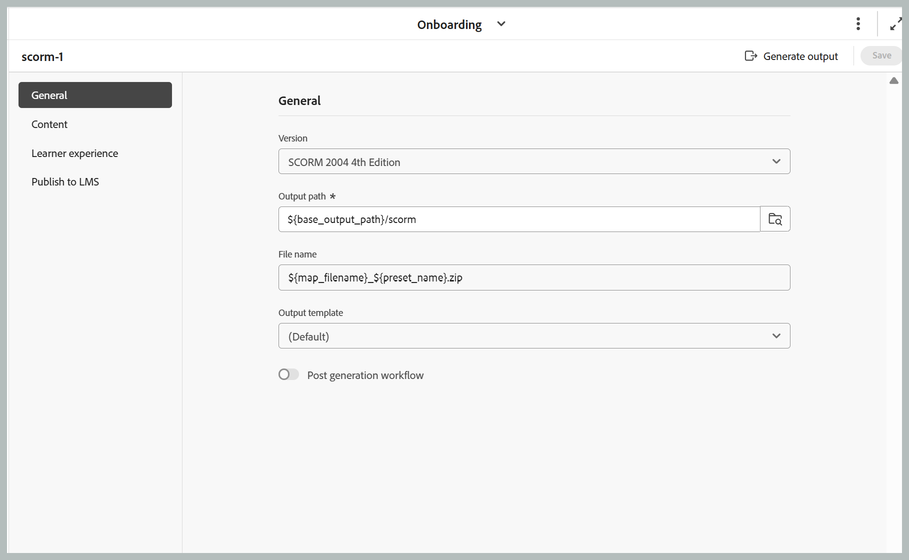
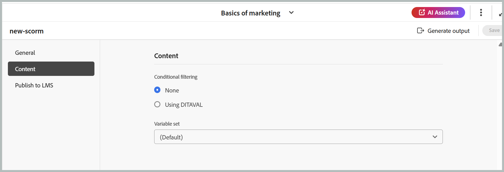
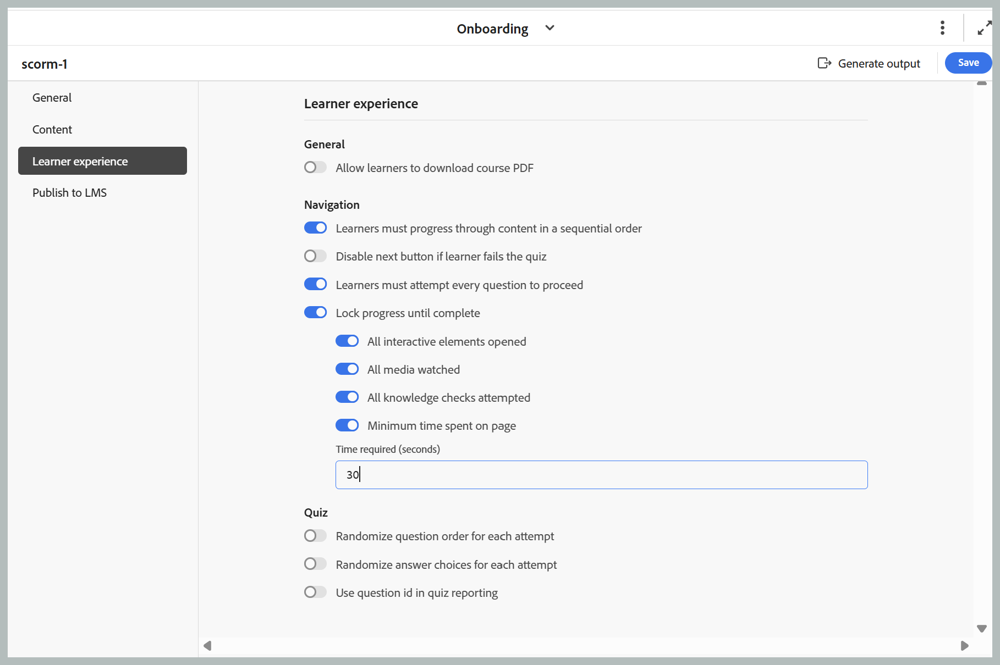
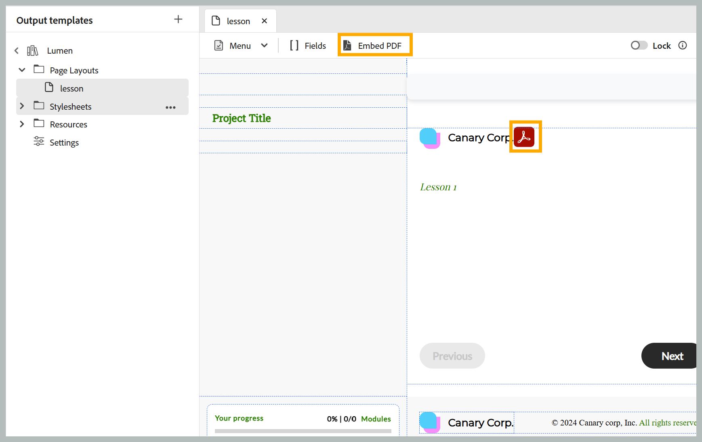
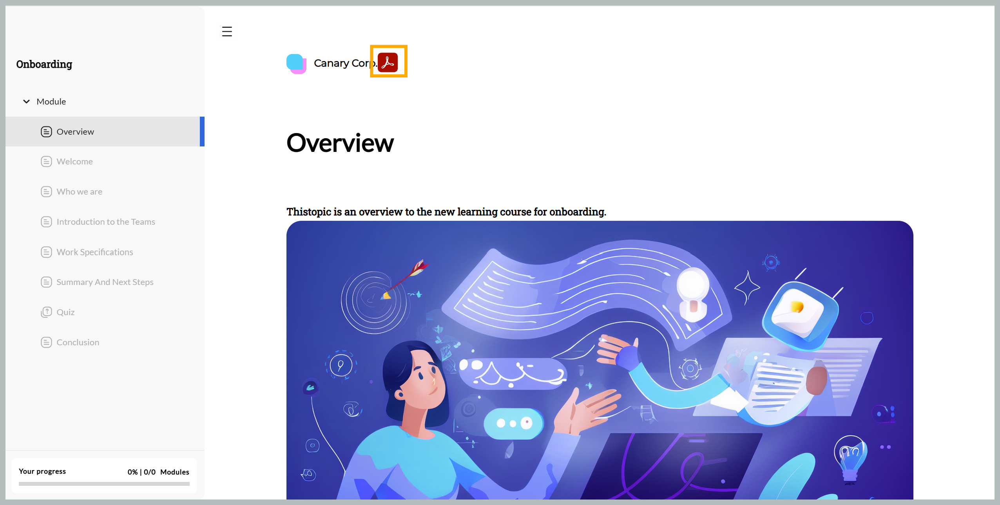
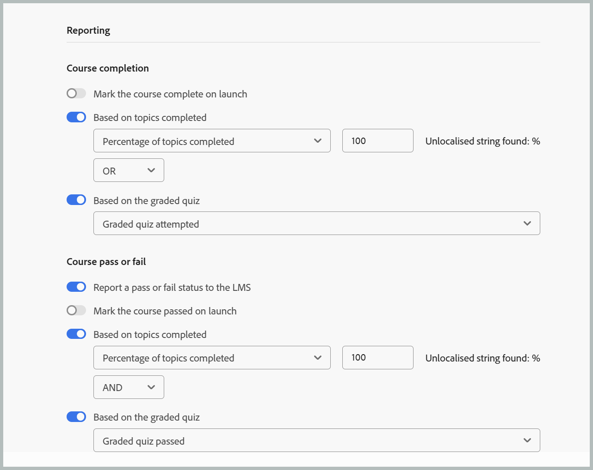
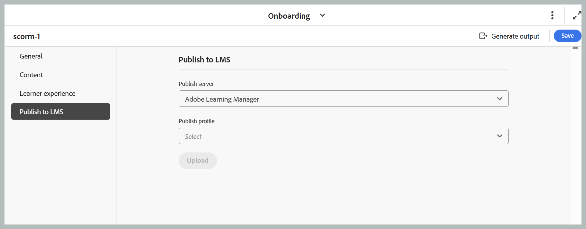

# Configuration du paramètre prédéfini de sortie SCORM

Une fois le paramètre prédéfini créé, configurez-le. Les options de configuration prédéfinies sont organisées sous les onglets Général, Contenu, Expérience de l’élève et Publication.

- **Général :** utilisé pour spécifier des paramètres de sortie de base, tels que la version prise en charge, le chemin de sortie, le nom de fichier SCORM (zip), le modèle de sortie et le workflow de post-génération pour une nouvelle liste déroulante de workflow de post-génération contenant tous les workflows configurés.

  {width="650"}

- **Contenu :** permet de spécifier le filtrage conditionnel disponible (à l’aide de DITAVAL ou d’un paramètre prédéfini de condition) et le jeu de variables.

  {width="650"}

- **Expérience de l’élève :** l’onglet **Expérience de l’élève** vous permet de configurer la manière dont les élèves interagissent avec la sortie SCORM et la parcourent. Les paramètres sont organisés sous **Général**, **Navigation** et **Quiz**, ce qui vous permet de contrôler l’accessibilité du contenu, le flux de navigation et le comportement du quiz pour une expérience d’apprentissage personnalisée.

  {width="650"}

  - **Général :** configurer des options au niveau de la sortie, telles que l’activation des téléchargements PDF pour les élèves.

    - **Autoriser les élèves à télécharger le cours PDF** : lorsqu’elle est activée, cette option ajoute une icône PDF à la sortie SCORM. Cliquez sur cette icône pour permettre à l’élève de télécharger une version PDF du contenu du cours directement depuis la sortie publiée.

      **Conditions préalables :** Avant d’activer cette option, vérifiez les points suivants :

      - Le **modèle de sortie** doit être configuré avec l’icône **Incorporer PDF** à l’emplacement souhaité et le même modèle doit être sélectionné sous l’option **modèle de sortie** de l’onglet **Général** lors de la configuration d’un paramètre prédéfini SCORM.

        {width="650"}

      - Le **paramètre prédéfini de PDF natif** associé doit avoir été généré au moins une fois. La sélection d’un paramètre prédéfini PDF non généré entraîne une erreur invitant l’utilisateur à publier le paramètre prédéfini.

    Une fois la sortie SCORM générée avec les paramètres ci-dessus, la sortie obtenue comprend une icône PDF, comme illustré ci-dessous, qui permet aux élèves de télécharger le cours PDF.

    {width="650"}

  - **Navigation :** définit la manière dont les élèves se déplacent dans le cours, y compris la progression séquentielle, les conditions d’achèvement obligatoires et les règles de déverrouillage du bouton **Suivant**.

    - **Les élèves doivent progresser dans le contenu dans un ordre séquentiel** : garantit que les élèves suivent le cours dans une séquence fixe et ne peuvent pas avancer ou passer d’un composant de cours à l’autre.
    - **Désactiver le bouton suivant si l’élève n’a pas réussi le quiz** : empêche l’élève de passer à la section/page suivante jusqu’à ce qu’il ait réussi le quiz.
    - **Les élèves doivent répondre à chaque question pour continuer** : nécessite que les élèves répondent à toutes les questions avant de pouvoir envoyer le quiz, ce qui empêche les envois incomplets.
    - **Verrouiller la progression jusqu’à la fin** : empêche la navigation dans le cours jusqu’à ce que toutes les sous-conditions configurées ci-dessous soient remplies en désactivant le bouton **Suivant** dans le cours.
      - **Tous les éléments interactifs ouverts** : nécessite que l’élève ouvre chaque élément interactif de la page.
      - **Tous les médias regardés** : nécessite que l’élève regarde tous les médias vidéo/audio de la page.
      - **Toutes les vérifications de connaissances ont été tentées** : nécessite que l’élève tente de répondre à chaque question de vérification de connaissances sur la page.
      - **Durée minimale de consultation de la page** : l’élève doit rester sur la page pendant au moins la durée spécifiée avant que le bouton Suivant ne soit activé. Une fois activé, vous devez saisir le temps nécessaire, comme indiqué ci-dessous.
        - **Durée requise (secondes)** : nombre minimum de secondes (par exemple, `30`) pendant lesquelles un élève doit rester sur la page pour que cette condition soit remplie.

  - **Quiz :** configurez le comportement lié au quiz, tel que la randomisation de l’ordre des questions et des choix de réponses pour réduire la prévisibilité entre les tentatives.

    - **Ordre aléatoire des questions pour chaque tentative** : affiche les questions du quiz dans un ordre différent pour chaque tentative, ce qui contribue à réduire la prévisibilité.
    - **Randomiser les choix de réponses pour chaque tentative** : mélange les options de réponse pour chaque question à chaque tentative, ce qui réduit les chances de deviner.

  - **Création de rapports** : utilisez ces paramètres pour déterminer à quel moment l’achèvement du cours et le statut réussite/échec sont publiés dans Adobe Learning Manager (ALM).

    

    - **Fin de cours** : définit le moment où le cours est marqué comme terminé et publié dans ALM.

      - **Marquer le cours comme terminé au lancement** : marque le cours comme terminé pour l’élève dès qu’il est lancé. L’élève n’est pas tenu d’interagir avec du contenu. Cette option est rarement nécessaire, mais elle est disponible si votre workflow l’exige.
      - **En fonction des sujets terminés** : marque le cours comme terminé une fois que l’élève a atteint un **pourcentage** ou **nombre** spécifié de sujets terminés. Choisissez l’unité, le pourcentage ou le nombre qui correspond à la façon dont vous souhaitez définir le seuil d’achèvement.
      - **En fonction du quiz noté** : marque le cours comme étant terminé en fonction du statut du quiz de l’élève, sélectionné dans la liste déroulante :

        - **Quiz noté tenté**
        - **quiz évalué réussi**
        - **Quiz noté réussi ou limite de tentative atteinte**

      Lorsque les options **Basé sur les rubriques terminées** et **Basé sur le quiz évalué** sont activées, utilisez le sélecteur **AND**/**OR** pour définir la manière dont les deux conditions se combinent :

      - **AND** : les deux conditions doivent être vraies.
      - **OR** : l’une ou l’autre des conditions est suffisante.

    - **Succès ou échec du cours** : définit le moment où le statut de réussite ou d’échec est publié dans ALM. Le signalement d’un statut de réussite ou d’échec est facultatif.

      - **Signaler un statut de réussite ou d’échec à LMS** : désactivez cette option si vous ne souhaitez pas que le statut de réussite/échec soit publié dans ALM. Lorsqu’elles sont désactivées, les options restantes de ce groupe sont masquées.
      - **Marquer le cours comme réussi au lancement** : marque le cours comme réussi pour l’élève dès son lancement.
      - **En fonction des sujets terminés** : marque le cours comme terminé une fois que l’élève a atteint un **pourcentage** ou **nombre** spécifié de sujets terminés. Choisissez l’unité, le pourcentage ou le nombre qui correspond à la façon dont vous souhaitez définir le seuil d’achèvement.
      - **En fonction du quiz noté** : marque la réussite ou l’échec du cours en fonction du statut du quiz de l’élève, sélectionné dans la liste déroulante

        - Quiz noté tenté
        - Quiz noté réussi

      Lorsque les options **Basé sur les rubriques terminées** et **Basé sur le quiz évalué** sont activées, utilisez le sélecteur **AND**/**OR** pour les combiner, comme décrit ci-dessus.

    >[!NOTE]
    >
    >Par défaut, ces paramètres correspondent au comportement précédent : achèvement à 100 % des rubriques terminées et réussite en fonction de la réussite du quiz évalué et de la fin de 100 % des rubriques. Cela s’applique aux nouveaux paramètres prédéfinis SCORM et aux paramètres prédéfinis existants. Par conséquent, rien ne change pour les cours existants, sauf si vous reconfigurez ces paramètres.

- **Publier dans LMS :** utilisez ce paramètre pour publier votre contenu directement dans Adobe Learning Manager (ALM). Dans la liste déroulante **Serveur de publication**, sélectionnez **Adobe Learning Manager**, puis choisissez le **Profil de publication** requis précédemment configuré dans les paramètres de Workspace. Le profil sélectionné est utilisé pour établir la connexion et charger le contenu généré vers AEM.

  >[!NOTE]
  >
  > Avant de publier du contenu dans ALM, vous devez configurer un profil de publication Adobe Learning Manager. Pour plus d’informations, consultez [Publication de profils](../lc-config-guide/lc-folder-profile.md).

  {width="650"}

Une fois toutes les modifications configurées, enregistrez-les pour le paramètre prédéfini SCORM à l’aide de l’option **Enregistrer** dans le coin droit de la barre d’outils de la page du paramètre prédéfini SCORM.
