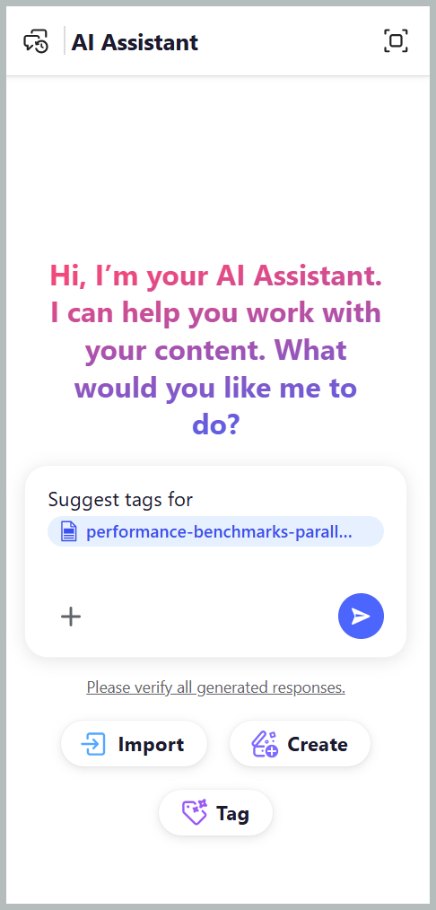
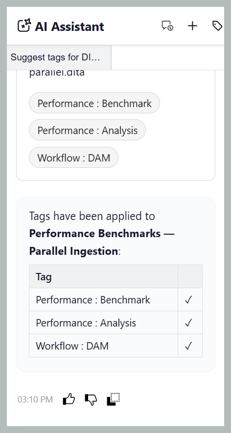

# Balisage intelligent avec l’assistant AI

La compétence Balisage intelligent, disponible en mode Agence de l’assistant AI via Adobe CX Enterprise Coworker, rend le balisage de votre contenu plus rapide, plus facile et plus cohérent. Il analyse votre contenu et recommande des balises pertinentes en fonction de la taxonomie de votre entreprise, ce qui élimine la nécessité de réviser manuellement le contenu et d’identifier les balises applicables. Votre administrateur peut configurer les taxonomies utilisées pour générer des recommandations de balises via les paramètres [&#128279;](../install-conf-guide/workspace-settings.md#general) en sélectionnant les espaces de noms appropriés pour votre espace de travail.

Vous gardez le contrôle en examinant les balises suggérées et en choisissant de les appliquer ou de les rejeter avant de confirmer votre sélection. Cela réduit les efforts manuels, améliore la précision du balisage et permet de maintenir des métadonnées cohérentes dans l’ensemble de votre documentation.

## Appliquer des balises à une ou plusieurs rubriques avec la compétence de balisage intelligent

Effectuez les étapes suivantes pour utiliser l’assistant AI afin d’appliquer des balises à une ou plusieurs rubriques avec la compétence de balisage intelligent :

1. Connectez-vous à Experience Manager Guides.
1. Sur la page d’accueil, sélectionnez **Assistant AI** dans la barre de navigation. Assurez-vous que l’assistant [AI en mode Agence](../install-conf-guide/workspace-settings.md) est activé par l’administrateur.
1. Ajoutez la rubrique pour laquelle vous souhaitez générer des recommandations de balises à l’aide de l’une des méthodes suivantes :

   - **Utilisation d’invites suggérées** : pour la première conversation de la zone Réponse, sélectionnez **Suggérer des balises pour une invite de fichier**. L’invite est automatiquement ajoutée à l’espace Invite . Sélectionnez `[file]`, puis choisissez la rubrique dans le référentiel ou dans une collection de la boîte de dialogue **Sélectionner un fichier**. Vous pouvez sélectionner une rubrique dans la boîte de dialogue **Sélectionner un fichier**.

     {width="650"}

   - **Utilisation d’un raccourci** : saisissez `/` dans le champ Invite, puis choisissez **Ajouter une référence au référentiel** pour choisir une rubrique dans le référentiel (ou **Ajouter des fichiers à partir de l’appareil** pour charger une rubrique à partir de votre ordinateur) et saisissez une invite du type *Suggérer des balises pour un fichier*.

   - **Glisser-déposer** : faites glisser et déposez une ou plusieurs rubriques dans l’espace Invite, puis saisissez une invite du type *Suggérer des balises pour un fichier*.

     {width="650"}

   - **Spécifier les chemins d’accès aux rubriques** : saisissez `@` suivis des chemins séparés par des virgules pour plusieurs rubriques à partir de la même carte ou de cartes différentes, puis saisissez une invite du type *Suggérer des balises pour un fichier*.

     {width="650"}

1. Sélectionnez **Envoyer**.

1. L’assistant AI analyse le contenu de la rubrique et génère des recommandations de balises.

   {width="650"}

1. Examinez les balises suggérées comme suit :

   >[!NOTE]
   >
   > Pour les rubriques qui contiennent déjà des balises, l’assistant AI affiche les balises existantes. Ces balises sont en lecture seule et ne peuvent pas être modifiées ni supprimées.

   - Pour une seule rubrique, vous pouvez **Accepter** les recommandations pour les appliquer ou **Rejeter** si elles ne sont pas nécessaires.

     {width="650"}

   - Pour plusieurs rubriques :
     1. Sélectionnez **Aperçu** pour consulter les recommandations de balises générées par l’IA.

        {width="650"}

     1. Passez en revue les balises suggérées pour chaque rubrique, puis choisissez l’une des actions suivantes :
        - **Accepter tout** pour appliquer toutes les balises suggérées à toutes les rubriques.
        - **Rejeter tout** pour ignorer toutes les balises suggérées pour toutes les rubriques.
        - **Effacer toutes les suggestions** pour supprimer toutes les balises suggérées pour une rubrique spécifique.
        - Sélectionnez l’icône **X** en regard d’une balise pour supprimer une suggestion de balise individuelle.

          {width="650"}

1. Lorsque vous acceptez les balises suggérées, la compétence Balisage intelligent ajoute les balises générées par l’IA aux balises déjà appliquées au contenu.

Une fois la révision terminée, l’assistant AI affiche un résumé des balises appliquées à la rubrique et des recommandations de balises rejetées.

{width="650"}

## Appliquer des balises à plusieurs rubriques d’une carte à l’aide des compétences de balisage intelligent

Effectuez les étapes suivantes pour utiliser l’assistant AI afin d’appliquer des balises à plusieurs rubriques d’une carte avec les compétences de balisage intelligent :

1. Connectez-vous à Experience Manager Guides.
1. Sur la page d’accueil, sélectionnez **Assistant AI** dans la barre de navigation. Assurez-vous que l’assistant AI en mode Agence est activé par l’administrateur.
1. Ajoutez le mappage pour lequel vous souhaitez générer des recommandations de balises à l’aide de l’une des méthodes suivantes, comme indiqué pour les rubriques :

   - **Utilisation d’invites suggérées** : pour la première conversation de la zone Réponse, sélectionnez **Suggérer des balises pour une invite de fichier**. L’invite est automatiquement ajoutée à l’espace Invite . Sélectionnez `[file]`, puis choisissez le mappage dans le référentiel ou dans une collection de la boîte de dialogue **Sélectionner un fichier**.

   - **Glisser-déposer** : faites glisser et déposez une carte dans l’espace Invite, puis saisissez une invite du type *Suggérer des balises pour un fichier*.

   - **À l’aide d’un raccourci** : saisissez `/` dans le champ Invite, puis choisissez **Ajouter une référence au référentiel** pour choisir un mappage dans le référentiel (ou **Ajouter des fichiers à partir de l’appareil** pour charger un mappage à partir de votre ordinateur) et saisissez une invite du type *Suggérer des balises pour un fichier*.

     {width="650"}

1. Sélectionnez **Envoyer**.
Un message indique que la carte sélectionnée contient plusieurs rubriques. Sélectionnez **Sélectionner les rubriques** pour choisir les rubriques pour lesquelles vous souhaitez obtenir des recommandations de balises.

   {width="650"}

1. Dans la boîte de dialogue **Sélectionner les rubriques**, sélectionnez les rubriques pour lesquelles vous souhaitez des recommandations de balises.\
   La boîte de dialogue **Sélectionner les rubriques** fournit les informations suivantes :

   - **Liste Rubriques :** affiche toutes les rubriques de la carte sélectionnée. Sélectionnez les rubriques pour lesquelles vous souhaitez générer des recommandations de balises.
   - **Volet Aperçu :** affiche un aperçu de la rubrique sélectionnée avec ses balises existantes.
   - **Filtrer :** filtrez les rubriques pour n’afficher que celles contenant **Balises ajoutées** ou **Aucune balise ajoutée**.

     {width="650"}

1. Sélectionnez **Confirmer**. L’assistant AI analyse les rubriques sélectionnées et affiche le nombre de recommandations de balises générées pour chaque rubrique.
1. Sélectionnez **Aperçu** pour consulter les recommandations de balises générées par l’IA.
1. Passez en revue les balises suggérées pour chaque rubrique, puis choisissez l’une des actions suivantes :
   - **Accepter** pour appliquer toutes les balises suggérées à toutes les rubriques.
   - **Rejeter** pour ignorer toutes les balises suggérées pour toutes les rubriques.
   - **Effacer toutes les suggestions** pour supprimer toutes les balises suggérées pour une rubrique spécifique.
   - Sélectionnez l’icône **X** en regard d’une balise pour supprimer une suggestion de balise individuelle.

     >[!NOTE]
     >
     > Pour les rubriques qui contiennent déjà des balises, l’assistant AI affiche les balises existantes. Ces balises sont en lecture seule et ne peuvent pas être modifiées ni supprimées.

   {width="650"}

1. Lorsque vous acceptez les balises suggérées, les compétences de balisage intelligent ajoutent les balises générées par l’IA aux balises déjà appliquées au contenu.

Une fois la révision terminée, l’assistant AI affiche un résumé des balises appliquées à chaque rubrique et toutes les recommandations de balises rejetées.

