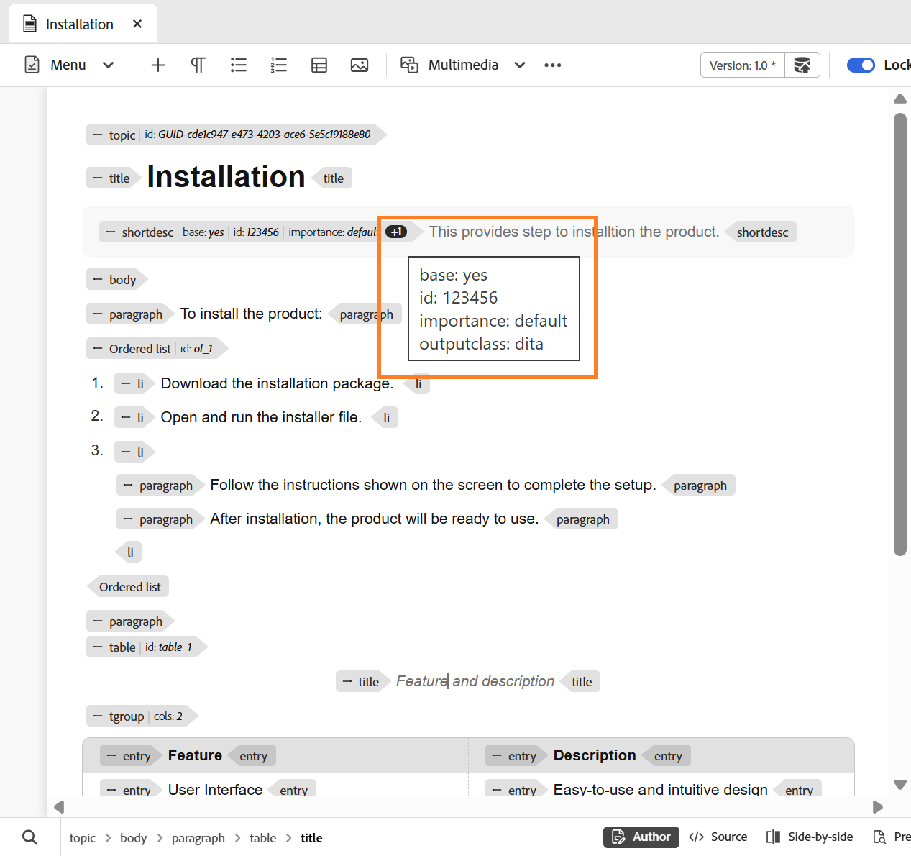

# Paramètres de l’éditeur

>[!NOTE]
>
> Cet article s’applique uniquement au nouvel éditeur. Pour activer cette fonctionnalité dans votre environnement, contactez l’équipe du service client AEM Guides.

Les paramètres de l’éditeur fournissent un panneau de configuration centralisé qui vous permet de personnaliser le comportement de l’éditeur au niveau de l’auteur individuel. Il offre davantage de flexibilité, de cohérence et de contrôle au cours du processus de création.

Ce panneau de paramètres centralisé vous permet de gérer les préférences clés de l’éditeur à partir d’un seul emplacement, ce qui réduit le besoin de configurations éparses ou manuelles. Les paramètres de l’éditeur sont accessibles à partir de la barre d’onglets **Autres actions**.

{width="650"}

## Options de configuration prises en charge

Les paramètres de l’éditeur vous permettent de personnaliser diverses options, notamment Suivi des modifications, Afficher les balises, Menu d’insertion rapide, etc., en fonction de vos préférences.

{width="350"}

### Suivi des modifications

>[!NOTE]
>
>- Cette fonctionnalité est activée par défaut. Pour la désactiver, contactez l’équipe du succès client d’AEM Guides.
>- Lorsque vous utilisez des tableaux, l’insertion d’une ligne ou d’une colonne est suivie, mais la suppression d’une ligne ou d’une colonne n’est pas suivie dans le panneau Suivi des modifications .

Activez le mode **Suivi des modifications** pour enregistrer les modifications apportées à une rubrique. Une fois qu’il est activé, chaque insertion et suppression est capturée au fur et à mesure que vous travaillez et toutes les modifications sont répertoriées dans le panneau **Suivi des modifications**. Les modifications consécutives effectuées à la même position sont regroupées et affichées comme une modification unique dans le panneau **Suivi des modifications**.

Le contenu supprimé apparaît barré, tandis que le contenu inséré apparaît en vert. En outre, des barres de modification apparaissent le long du bord de la page de rubrique, avec des barres rouges indiquant le contenu supprimé et des barres vertes indiquant le contenu ajouté. Si une ligne contient à la fois des ajouts et des suppressions, les deux barres de modification s’affichent.

Lorsque plusieurs utilisateurs travaillent sur le même sujet, le Suivi des modifications leur permet d’afficher les modifications les uns des autres. Une fois que le contenu est prêt à être finalisé, les utilisateurs et utilisatrices peuvent réviser les modifications suivies et les accepter ou les rejeter.

{width="350"}

**Afficher les suppressions suivies en ligne**

Contrôle la manière dont le contenu supprimé est affiché dans l’éditeur lorsque le Suivi des modifications est activé. Lorsqu’il est activé, le contenu supprimé reste visible en ligne, à sa position d’origine, sous la forme d’un texte barré. Lorsqu’il est désactivé, le contenu supprimé n’est pas affiché. À la place, une icône en forme de crayon s’affiche à l’emplacement où le contenu a été supprimé, ce qui vous donne une vue plus nette de votre rubrique. Sélectionnez l’icône en forme de crayon pour accéder au contenu supprimé correspondant dans le panneau Modifications suivies .

{width="350"}

**Accepter ou refuser les modifications suivies**

Pour passer en revue les modifications, sélectionnez l’icône **Suivi des modifications** dans le panneau de droite pour ouvrir le panneau Modifications suivies et effectuez les étapes suivantes :

1. Sélectionnez une modification suivie dans le panneau. Le contenu modifié est sélectionné dans le document.
1. Acceptez la modification en sélectionnant l’icône **Accepter la modification** ou rejetez-la en sélectionnant l’icône **Rejeter la modification**.

   {width="650"}

1. Pour accepter ou rejeter toutes les modifications en un seul clic, sélectionnez **Accepter toutes les modifications** ou **Rejeter toutes les modifications** dans la partie supérieure du panneau.

   {width="650"}

### Espaces insécables

Activez cette option pour afficher un indicateur pour les espaces insécables lors de la modification dans l’éditeur. Il est visible uniquement dans la vue Auteur pour les plans DITA et Topic.

### Commentaires XML

Permet aux créateurs et créatrices d’afficher, de modifier et d’insérer des commentaires XML directement en mode Création, pour une meilleure visibilité dans le contenu. Lorsque cette option est activée, les auteurs peuvent afficher, insérer, modifier et supprimer des commentaires XML directement dans le contenu en mode de création lui-même, ce qui facilite l’ajout de notes contextuelles pour les collaborateurs. Lorsqu’ils sont désactivés, les commentaires XML sont masqués en mode de création et ne peuvent pas être insérés ou modifiés à partir du mode de création, ce qui garantit une expérience de création plus épurée pour les utilisateurs qui n’en ont pas besoin. Vous pouvez continuer à afficher et à créer des commentaires XML en mode source à l’aide de la syntaxe `<!-- test comment -->`.

>[!NOTE]
>
> Pour les commentaires XML, **Suivi des modifications** enregistre uniquement l’insertion ou la suppression de l’intégralité du commentaire. Les modifications apportées à un commentaire XML existant ne sont pas enregistrées.

{width="650"}

### Balises

Contrôle la visibilité des balises dans l’éditeur. Lorsqu&#39;elles sont activées, les balises structurelles sont affichées dans le contenu, ce qui permet aux auteurs d&#39;afficher et de gérer la structure DITA sous-jacente. Lorsqu’elles sont désactivées, ces balises sont masquées pour offrir une expérience de création plus épurée et plus ciblée.

{width="650"}

Lorsque les paramètres **Afficher les balises** sont activés, vous pouvez également activer **Afficher les attributs** pour afficher et valider les attributs associés à un élément. Lorsqu’un élément est associé à plus de trois attributs, un indicateur de comptage s’affiche. Placer le pointeur de la souris sur l’indicateur affiche la liste complète des attributs appliqués à cet élément.

     {width=« 650 »}

### Menu d’insertion rapide dans l’éditeur

Permet d’ajouter des éléments directement lors de la modification en mode Création à l’emplacement du curseur sans accéder à la barre d’outils. Les éléments fréquemment utilisés peuvent également être configurés dans les **Favoris** pour un accès plus rapide. Le menu d’insertion rapide est disponible directement dans l’éditeur lorsque vous appuyez sur **Ctrl + /** sous Windows ou **Commande + /** sous macOS pour positionner le curseur.

{width="650"}

Vous pouvez rechercher et ajouter des éléments à vos favoris, supprimer des éléments précédemment ajoutés et les réorganiser en effectuant simplement un glisser-déposer. Les éléments les plus fréquemment utilisés figurent parmi les favoris et l&#39;ordre que vous définissez ici est reflété dans le menu Insertion rapide lorsque vous y accédez à partir de l&#39;éditeur.

Regardez cette courte vidéo sur l’utilisation du menu d’insertion rapide dans le nouvel éditeur.

>[!VIDEO](https://video.tv.adobe.com/v/3491343)

