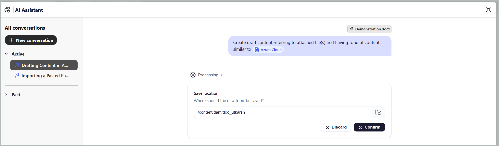
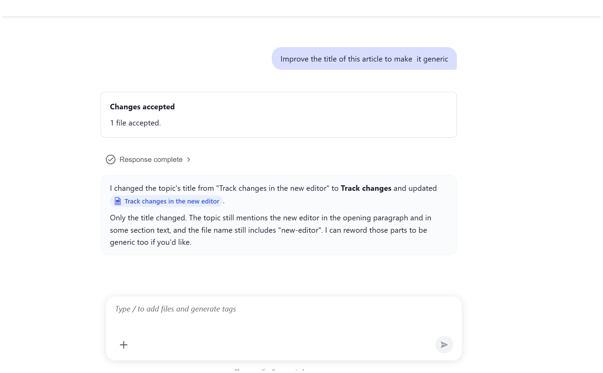

# Créer le premier brouillon de votre contenu

Les compétences **Créer** dans le mode Agence de l’assistant d’IA vous permettent de générer la première version du contenu structuré à partir de notes, de spécifications, d’images de tableau blanc, de captures d’écran ou d’autres documents de référence disponibles. Cette compétence identifie automatiquement le type de rubrique DITA approprié, tel que Concept, Tâche, Référence ou Dépannage, en fonction du contenu et des modèles de rubrique disponibles dans votre référentiel, ce qui réduit la charge de travail manuelle nécessaire pour structurer et créer du contenu.

Vous pouvez joindre un fichier, sélectionner un fichier existant comme référence pour le ton et le style, puis spécifier le dossier dans lequel vous souhaitez enregistrer le contenu généré. Pour créer le premier brouillon du contenu de votre choix, procédez comme suit :

1. Connectez-vous à Experience Manager Guides.
1. Sur la page d’accueil, sélectionnez **Assistant AI** dans la barre de navigation. Assurez-vous que l’assistant [AI en mode Agence](../install-conf-guide/workspace-settings.md) est activé par l’administrateur.

1. Sélectionnez **Créer** dans le panneau de l’assistant d’IA.

   L’invite de démarrage s’affiche dans la zone d’invite : *Créer un brouillon de contenu faisant référence au(x) fichier(s) joint(s) et dont le ton du contenu est similaire à celui du [fichier]*

1. Joignez vos notes, votre spécification ou d’autres fichiers de référence à l’invite à l’aide de l’une des méthodes suivantes :

   - **Utilisation d’un raccourci** : saisissez `/` dans le champ Invite, puis choisissez **Ajouter une référence au référentiel** pour choisir le fichier dans le référentiel (ou **Ajouter des fichiers à partir de l’appareil** pour télécharger le fichier depuis votre ordinateur).

   - **À l’aide de l’icône Joindre des fichiers ou Ajouter un contexte (+)** : ajoute les fichiers de votre système local.

   - **Glisser-déposer** : faites glisser et déposez le fichier que vous souhaitez brouiller du système directement dans l’espace d’invite.

1. *(Facultatif)* Dans l’invite de démarrage, sélectionnez `[file]`. Sélectionnez la rubrique existante dont vous souhaitez que le brouillon corresponde au ton. Vous pouvez choisir la rubrique dans le référentiel ou dans une collection. Le nom de la rubrique remplace `[file]` dans l’invite.

   {width="350"}

1. Sélectionnez **Envoyer**.

   L’assistant AI analyse le contenu et répertorie chaque étape qu’il effectue.

1. Répondez à toutes les questions de suivi de l’assistant AI pour fournir les détails nécessaires à la génération du contenu.

   {width="350"}

1. Sélectionnez **Aperçu** pour passer en revue la rubrique générée.

   Vérifiez chaque brouillon par rapport à votre matériau source et aux types de sujet que vous avez demandés.

   

1. Effectuez l’une des actions suivantes :

   - **Accepter** pour enregistrer la rubrique dans le dossier que vous avez confirmé
   - **Rejeter** pour ignorer les modifications sans rien enregistrer. Vous pouvez indiquer une raison pour laquelle le contenu du brouillon est rejeté et saisir une invite spécifiant les modifications que vous souhaitez apporter. L’assistant AI utilise vos commentaires pour réviser le contenu du brouillon.

     La rubrique est désormais disponible dans votre référentiel.

     

Une fois que l’assistant AI a créé une rubrique, vous pouvez l’ouvrir dans l’éditeur et affiner le contenu à l’aide d’invites de relance. Cela vous permet d’améliorer le sujet de manière itérative sans démarrer une nouvelle conversation. Chaque modification proposée s’affiche dans l’aperçu avec l’option **Suivi des modifications** activée, ce qui vous permet de vérifier les modifications avant de les appliquer.

Par exemple, pour affiner le titre d’une rubrique générée :

1. Ouvrez la rubrique que vous venez de créer dans l’éditeur à partir de la boîte de dialogue Assistant IA .

   

1. Dans le panneau de l’assistant d’IA, saisissez une invite de relance, telle que `Improve the title of this topic to make it generic.`

   

1. Sélectionnez **Envoyer**.

   AI Assistant analyse et suggère un nouveau titre.

1. Sélectionnez **Aperçu** pour passer en revue les modifications proposées.

   L’aperçu affiche le titre révisé avec les modifications suivies, en mettant en surbrillance ce qui a été modifié.

   

1. Sélectionnez **Accepter** pour appliquer les modifications à la rubrique.

   

Vous pouvez continuer à affiner d’autres éléments du sujet, tels que des paragraphes, des étapes ou des tableaux, en fournissant des invites supplémentaires dans la même conversation.

