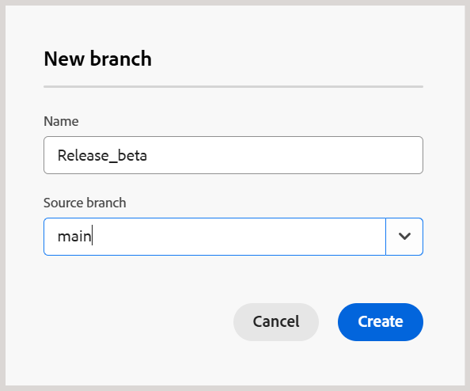
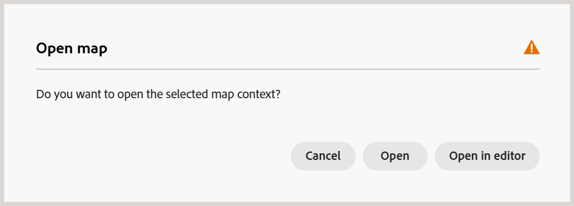

# Création et gestion des branches d&#39;un plan DITA

Dans Experience Manager Guides, vous pouvez créer plusieurs branches d&#39;un plan DITA afin de gérer la documentation de différentes versions, fonctionnalités ou correctifs. Vous pouvez basculer entre les branches pour travailler sur le contenu associé, archiver les branches qui ne sont plus nécessaires et les restaurer si nécessaire.

Vous pouvez également créer une branche à partir de n&#39;importe quelle branche existante du même plan DITA.

## Création d’une branche

Vous pouvez créer une branche d&#39;un plan DITA pour apporter des modifications à la documentation sans affecter le contenu correspondant dans d&#39;autres branches.

Pour créer une branche, procédez comme suit :

1. Ouvrez le plan DITA pour lequel vous souhaitez créer une branche.

   >[!NOTE]
   >
   > Si un autre mappage est déjà ouvert dans l’éditeur, une boîte de dialogue de confirmation s’affiche. Sélectionnez **Ouvrir** pour ouvrir la carte sélectionnée dans la branche active. Pour plus d’informations, voir [Ouvrir le contenu en dehors du contexte de carte actuel](#open-content-outside-the-current-map-context).

1. Sélectionnez la liste déroulante de branche **principale** et vérifiez que le plan DITA requis est sélectionné.

   

1. Sélectionnez **Nouvelle branche** pour créer une branche de la carte sélectionnée.

1. Dans la boîte de dialogue **Nouvelle branche**, saisissez le nom de la nouvelle branche et sélectionnez la branche parent à partir de laquelle vous souhaitez la créer.

   

1. Sélectionnez **Créer**.

Une nouvelle branche est créée pour le plan DITA sélectionné. Vous pouvez maintenant passer à la nouvelle branche et commencer à travailler sur son contenu associé.

## Basculer entre les branches

Effectuez les étapes suivantes pour changer de branche :

1. Sélectionnez la **liste déroulante de branche** en haut de l’éditeur (qui affiche `main` par défaut). La liste des branches disponibles pour le plan DITA sélectionné s&#39;affiche.
1. Sélectionnez la branche que vous souhaitez utiliser.

   

   La branche sélectionnée s’ouvre et son nom apparaît dans la liste déroulante de branche située en haut de l’éditeur, en remplaçant **principal**.

   

Vous pouvez maintenant travailler sur la carte et son contenu associé dans la branche sélectionnée.

>[!NOTE]
>
>Si une rubrique comporte des modifications non enregistrées lorsque vous changez de branche, une boîte de dialogue s’affiche vous invitant à enregistrer les modifications avant de passer à la branche sélectionnée.

Vous pouvez maintenant travailler sur la carte et son contenu associé dans la branche sélectionnée.

## Modification isolée dans une branche

Lorsque vous travaillez dans une branche d&#39;un plan DITA, les modifications apportées à son contenu restent dans la branche sélectionnée et n&#39;affectent pas le contenu correspondant dans les autres branches. Cela permet à plusieurs auteurs de travailler indépendamment sur les mêmes sujets dans différentes branches d’une carte.

Par défaut, les rubriques inchangées sont lues à partir de la branche source ou du `main`. Lorsque vous modifiez une rubrique dans la branche sélectionnée, elle devient une partie de cette branche. Toutes les modifications ultérieures apportées à la rubrique restent dans la branche sélectionnée.

Vous pouvez basculer entre les branches d&#39;un même plan DITA pour afficher et modifier leur contenu respectif.

### Modification de rubriques dans une branche

Vous pouvez modifier des rubriques associées à un plan DITA dans la branche sélectionnée sans affecter leur contenu dans d&#39;autres branches.

Pour modifier une rubrique, procédez comme suit :

1. Ouvrez le plan DITA dans l&#39;éditeur.
2. Dans la liste déroulante Branche , sélectionnez la branche dans laquelle vous souhaitez modifier la rubrique.
3. Ouvrez la rubrique à modifier à partir de la carte.
4. Apportez les modifications requises à la rubrique.
5. Enregistrez vos modifications.

   Une copie de la rubrique modifiée est enregistrée dans la branche sélectionnée. La rubrique correspondante dans les autres branches reste inchangée.

Vous pouvez continuer à modifier la rubrique dans la branche sélectionnée ou passer à une autre branche pour travailler sur son contenu.

### Ouvrir un mappage en dehors du contexte de mappage actuel

Dans Experience Manager Guides, **contexte du plan** fait référence au plan DITA actuellement ouvert dans l&#39;éditeur.

Si vous essayez d’ouvrir un mappage, une rubrique ou une ressource qui ne fait pas partie du contexte de mappage actuel, une boîte de dialogue de confirmation s’affiche avec les options suivantes :

- **Ouvrir :** remplace le contexte de carte actuel par le contenu sélectionné.
- **Ouvrir dans l’éditeur :** ouvre le contenu dans un nouvel onglet sans modifier le contexte de mappage actuel.
- **Annuler :** annule l’opération et conserve le contexte de mappage actuel.

Supposons, par exemple, que `master_map.ditamap` soit actuellement sélectionné dans la branche **principale**.

Si vous essayez d&#39;ouvrir un autre plan DITA, la boîte de dialogue de confirmation suivante s&#39;affiche :

Sélectionnez **Ouvrir** pour passer à la carte sélectionnée.

Le contexte de mappage de la branche `main` est mis à jour vers le mappage nouvellement sélectionné, ce qui vous permet d’utiliser le contenu associé.

### Ouvrir ou modifier les rubriques en dehors du contexte de carte actuel

Les rubriques qui ne sont pas référencées par le mappage ne sont pas automatiquement disponibles dans la branche .

Sélectionnez **Modifier dans la branche active** pour rendre ces rubriques modifiables dans la branche sélectionnée.

Vous pouvez désormais modifier la rubrique sans affecter son contenu dans `main`. Toutefois, la rubrique n&#39;est pas automatiquement ajoutée au plan DITA associé et n&#39;est pas incluse dans la sortie publiée. Pour inclure la rubrique dans la sortie, ajoutez-la au plan DITA.

## Gestion des branches

Vous pouvez gérer les branches d&#39;un plan DITA à partir du panneau **Branches** de la console Carte. Vous pouvez afficher les branches disponibles, créer de nouvelles branches, fusionner ou renommer les branches existantes et archiver les branches qui ne sont plus utilisées activement.

Le panneau **Branches** répertorie toutes les branches disponibles pour le plan DITA sélectionné.

Pour gérer une branche, pointez sur la branche souhaitée et sélectionnez le menu **Options**. Les actions disponibles sont les suivantes :

- **Nouvelle branche :** permet de créer une branche à partir de la branche sélectionnée.
- **Fusionner dans la branche principale :** [Fusionner les modifications](./merge-branches.md) de la branche sélectionnée dans la branche `main`.
- **Renommer la branche :** modifiez le nom de la branche sélectionnée.
- **Historique de fusion :** affiche l’historique des activités de fusion. Cette option n’est disponible qu’après la création d’une demande de fusion.
- **Archiver la branche :** permet d’archiver une branche qui n’est plus utilisée activement.

  >[!NOTE]
  >
  > Experience Manager Guides ne prend pas en charge la suppression de branches. Vous pouvez archiver les branches qui ne sont plus utilisées activement.

Vous pouvez également utiliser les options situées en haut du panneau **Branches** pour rechercher une branche, actualiser la liste des branches ou créer une branche.

### Archiver une branche

Vous pouvez archiver les branches d&#39;un plan DITA qui ne sont plus utilisées activement et les restaurer si nécessaire.

>[!NOTE]
>
> La branche par défaut (`main`) ne peut pas être archivée.

Pour archiver une branche, procédez comme suit :

1. Dans le panneau **Branches**, sélectionnez l’icône **Gérer**.

   

   La boîte de dialogue **Gérer les branches** s’affiche.

   

   La boîte de dialogue contient les onglets suivants :

   - **Actif :** répertorie toutes les branches actives du plan DITA sélectionné.
   - **Archivé :** répertorie toutes les branches archivées du plan DITA sélectionné.

2. Dans l’onglet **Actif**, pointez sur la branche à archiver et sélectionnez **Archiver**.

   

   La branche sélectionnée est archivée et déplacée vers l’onglet **Archivé**.

### Restaurer une branche archivée

Vous pouvez restaurer une branche archivée d&#39;un plan DITA lorsque vous devez reprendre à travailler sur son contenu.

Pour restaurer une branche archivée, procédez comme suit :

1. Dans le panneau **Branches**, sélectionnez l’icône **Gérer**.
2. Dans la boîte de dialogue **Gérer les branches**, sélectionnez l’onglet **Archivé**.
3. Recherchez la branche à restaurer et sélectionnez **Restaurer**.

   La branche est restaurée et apparaît dans l’onglet **Actif**.

