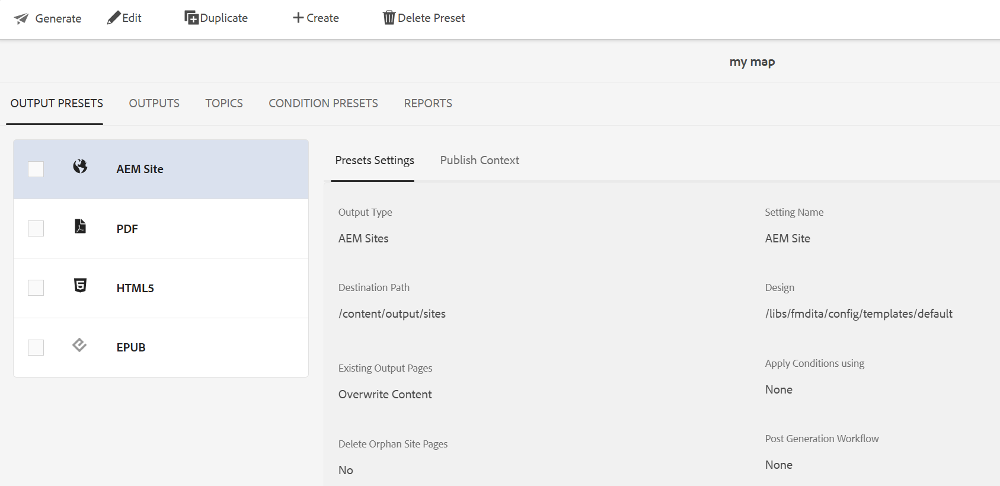

# Modification, duplication ou suppression d’un paramètre prédéfini de sortie {#id205BEH0K09Z}

Vous pouvez gérer les paramètres prédéfinis de sortie à partir de la console Map et du tableau de bord Map. Dans les deux cas, vous disposez d’options pour modifier, dupliquer et supprimer un paramètre prédéfini de sortie, comme illustré dans la section suivante.

## Utilisation de la console Carte

Vous pouvez modifier le paramètre prédéfini de sortie sélectionné en modifiant directement les champs obligatoires pour les paramètres prédéfinis nécessaires.

De plus, vous pouvez dupliquer ou supprimer un paramètre prédéfini de sortie à l’aide du menu déroulant **Options** comme illustré ci-dessous.

>[!NOTE]
>
>Vous ne pouvez pas modifier, dupliquer ou supprimer un paramètre prédéfini de modèle. Ces actions sont limitées aux administrateurs. Pour en savoir plus sur les paramètres prédéfinis de modèle, voir [ Paramètres prédéfinis de modèle ](../install-conf-guide/template-presets-output-generation.md).

## Utilisation du tableau de bord des cartes

Vous pouvez modifier, dupliquer et supprimer un paramètre prédéfini de sortie à l’aide du tableau de bord de mappage en sélectionnant l’onglet requis dans la barre supérieure, comme illustré ci-dessous.

**Rubrique parente :**[ Génération de sortie](generate-output.md)
