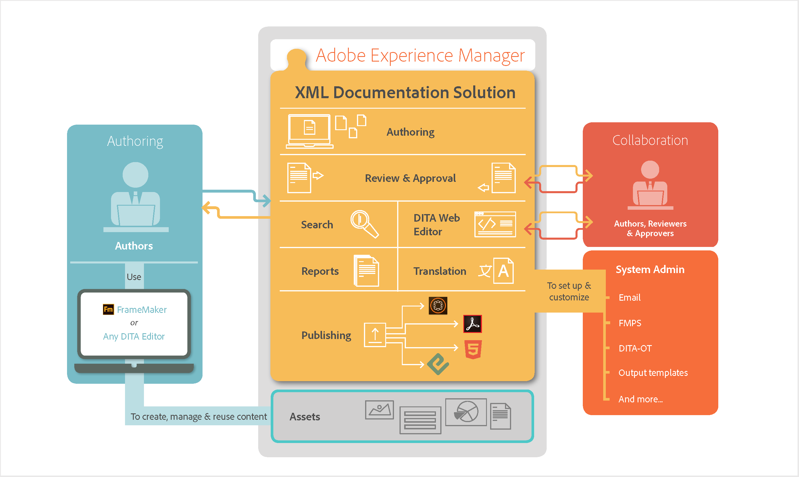

# Fonctionnement d’Adobe Experience Manager Guides {#id167G9A00DO4}

Le diagramme suivant illustre le fonctionnement de Experience Manager Guides avec AEM et tout éditeur DITA pour permettre la gestion, la réutilisation, la traduction et la révision de contenu dans un scénario d’entreprise.

{align="center"}

Lorsque vous utilisez l’un des workflows, si la session reste inactive pendant longtemps, une invite de temporisation de session est déclenchée pour empêcher la perte de contenu. Pour plus d’informations, voir [Délai d’expiration de la session](./session-timeout-prompt.md).

**Rubrique parente :**&#x200B;[&#x200B;À propos d’Adobe Experience Manager Guides as a Cloud Service](intro.md)
