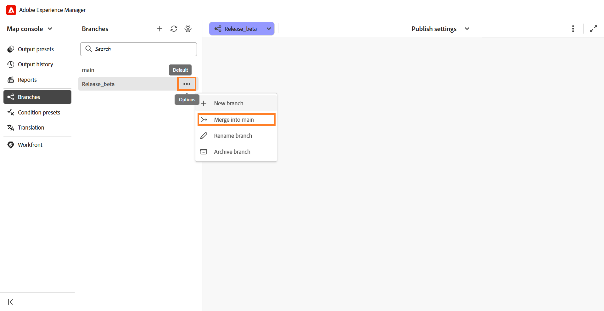
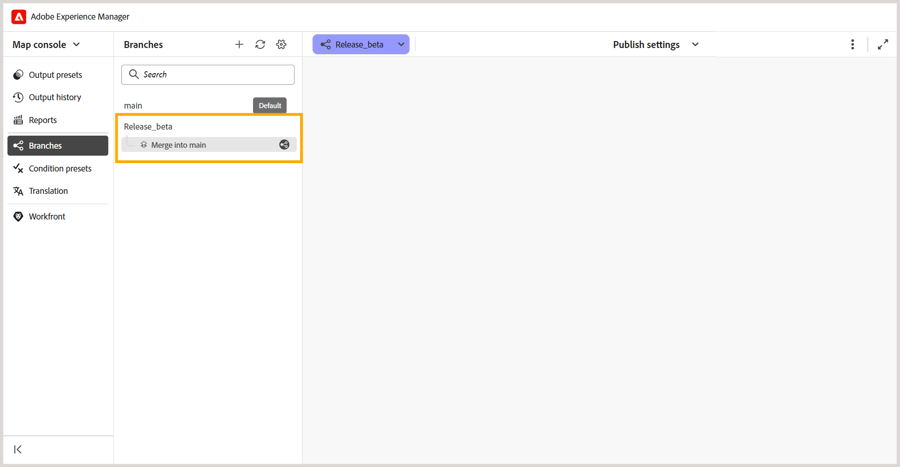
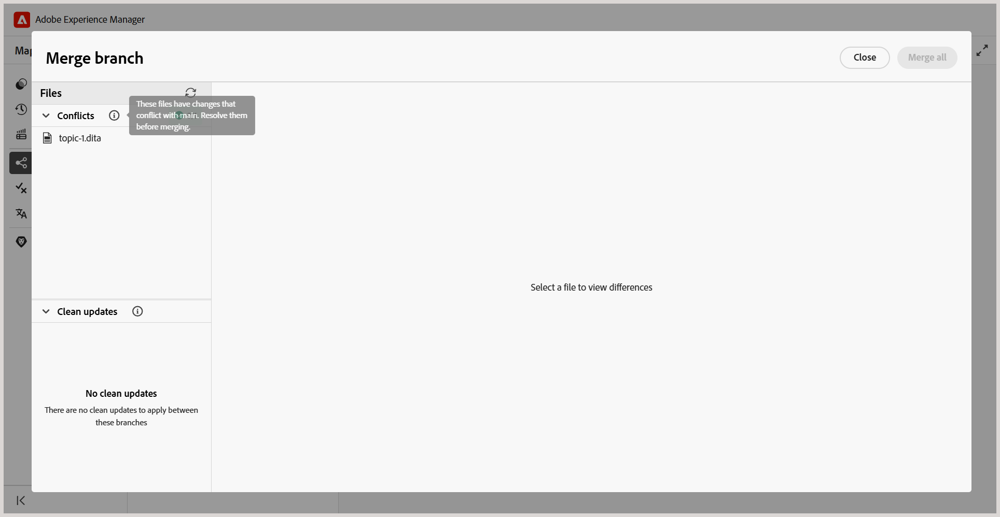
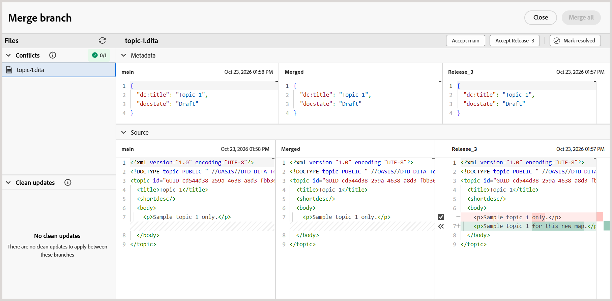
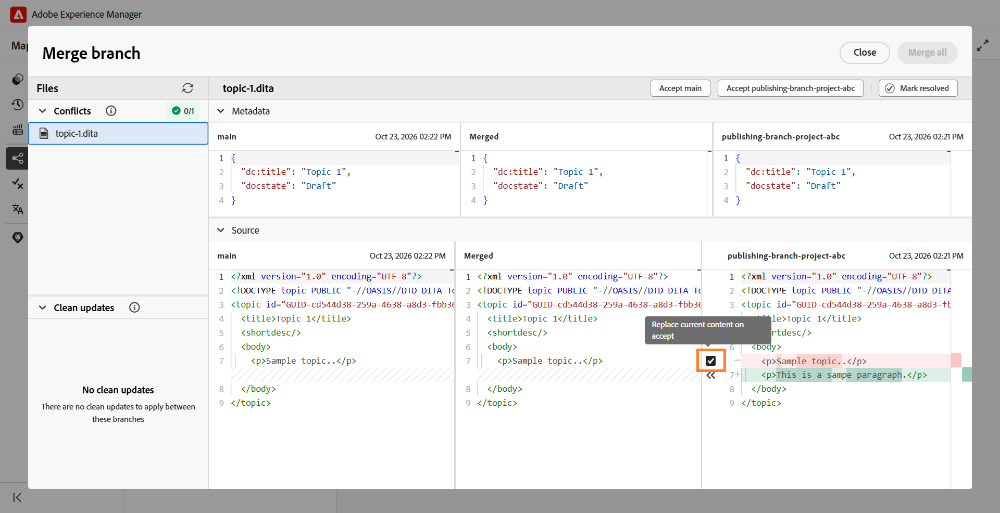
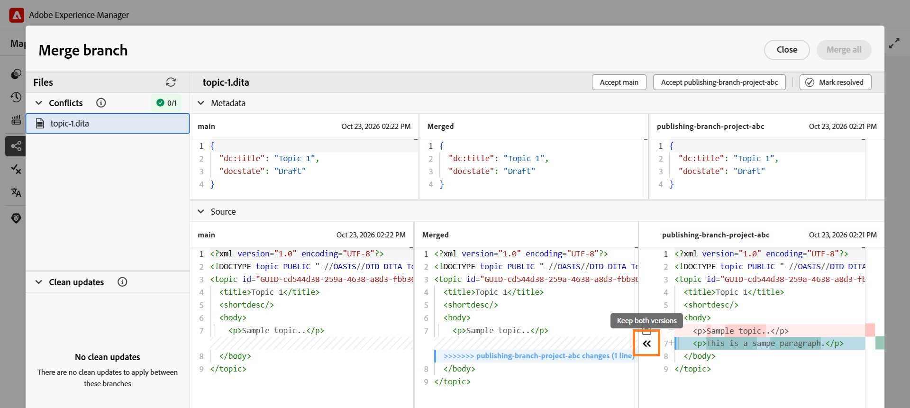

# Fusion d’une branche dans la

Dans Experience Manager Guides, vous pouvez fusionner les modifications d&#39;une branche d&#39;un plan DITA dans la branche `main`. La fusion vous permet d’incorporer les mises à jour de la documentation terminées dans `main` sans copier manuellement les modifications dans `main`.

Prenons l&#39;exemple d&#39;un plan DITA nommé `install-the-lift.ditamap` avec une branche nommée `Release 2`. Les auteurs peuvent mettre à jour les instructions d&#39;installation dans cette branche pendant que la documentation existante reste inchangée dans `main`.

Une fois les mises à jour prêtes, les auteurs peuvent fusionner les modifications de `Release 2` dans `main`.

## Comprendre la fusion des branches

La fusion apporte les modifications d&#39;une branche sélectionnée d&#39;un plan DITA dans la branche `main`.

- **Branche Source :** Branche contenant les modifications à fusionner.
- **Branche cible :** Branche par défaut (`main`) dans laquelle les modifications sont fusionnées.

Si la même partie d’une rubrique/d’un mappage a été modifiée dans les deux branches, des conflits de fusion peuvent se produire et nécessiter une résolution.

## Fusion d’une branche

Vous pouvez fusionner les modifications d&#39;une branche sélectionnée d&#39;un plan DITA dans `main`.

Pour fusionner une branche, procédez comme suit :

1. Ouvrez le plan DITA requis dans la console Map.
2. Accédez à l’onglet **Branches**.
3. Recherchez la branche contenant les modifications à fusionner.
4. Ouvrez le menu **Options** de la branche et sélectionnez **Fusionner dans la branche principale**.

   

   Une demande de fusion est créée pour la branche sélectionnée. Il vous permet de vérifier les modifications et de résoudre les conflits avant de les fusionner dans `main`.

   

5. Sélectionnez la demande de fusion.

   La demande de fusion s’ouvre dans la vue **Branche de fusion**. Passez en revue les modifications et résolvez les conflits, le cas échéant.
6. Terminez la fusion.

   Passez en revue les modifications et résolvez les conflits, le cas échéant. Pour plus d&#39;informations, consultez [Résoudre les conflits de fusion](#resolve-merge-conflicts).

   Une fois tous les conflits résolus, sélectionnez **Fusionner tout** pour fusionner les modifications dans `main`.

   Les modifications sont fusionnées dans la branche `main`.

## Résoudre les conflits de fusion

Un conflit de fusion se produit lorsque le même contenu a été modifié dans `main` et dans la branche en cours de fusion. Vous devez résoudre tous les conflits avant de fusionner les modifications dans `main`.

Lorsque vous ouvrez une demande de fusion, les sections suivantes s’affichent dans la vue **Branche de fusion** :

- **Conflits :** Répertorie les fichiers qui nécessitent une résolution de conflit.
- **Mises à jour propres :** Répertorie les fichiers qui peuvent être fusionnés sans résoudre les conflits.

Pour les fichiers présentant des conflits, une vue **Fusionner la branche** s’affiche.

La vue **Fusionner la branche** contient les volets suivants :

- **Volet de gauche (principal) :** affiche le contenu de la branche par défaut (`main`).
- **Volet central (fusionné) :** affiche le contenu fusionné, où vous pouvez accepter des modifications de l’une des branches ou modifier directement le contenu.
- **Volet de droite (branche sélectionnée) :** affiche le contenu de la branche fusionnée dans `main`.

Les différences sont mises en surbrillance dans les volets gauche et droit en fonction du contenu dans le volet **Fusionné** :

- **Rouge (-) :** Indique le contenu présent dans le volet **Fusionné** qui diffère du contenu dans le volet gauche ou droit correspondant.
- **Vert (+) :** indique le contenu présent dans le volet gauche ou droit qui n’est pas inclus dans le volet **Fusionné**.

Au départ, le volet **Fusionné** contient le même contenu que `main`, de sorte que les différences sont mises en évidence dans le volet de droite. Une fois que vous avez accepté les modifications de la branche sélectionnée, le volet de gauche affiche les différences par rapport au volet **Fusionné** mis à jour.

Procédez comme suit pour résoudre les conflits de fusion :

1. Dans la section **Conflits**, sélectionnez le fichier contenant les conflits.

   >[!NOTE]
   >
   > Les fichiers répertoriés sous **Mises à jour propres** contiennent des modifications apportées uniquement dans la branche sélectionnée et ne nécessitent donc pas de résolution de conflit.

2. Examinez les différences mises en évidence dans la vue **Fusionner la branche** et résolvez les conflits à l’aide des commandes de fusion.

   La case à cocher en regard d&#39;un conflit dans le volet de droite détermine la manière dont le contenu de branche sélectionné est ajouté au volet **Fusionné** :

   - **Sélectionné (par défaut) :** remplace le contenu correspondant dans le volet **Fusionné** par le contenu de branche sélectionné.
   - **Effacé :** ajoute le contenu de branche sélectionné avec le contenu existant dans le volet **Fusionné** sans le remplacer.

   Vous pouvez résoudre les conflits à l’aide des options suivantes :

   - Si vous souhaitez utiliser les modifications de la branche sélectionnée, gardez la case à cocher correspondant au conflit sélectionné, puis sélectionnez le contrôle fléché pointant vers la gauche correspondant (`<<<`). Le contenu de branche sélectionné remplace le contenu en conflit dans le volet **Fusionné**.

     

   - Si vous souhaitez conserver le contenu des deux branches, décochez la case correspondant au conflit, puis sélectionnez la commande fléchée pointant vers la gauche (`<<<`). Le contenu de branche sélectionné est ainsi ajouté au volet **Fusionné** sans remplacer le contenu déjà présent dans ce volet.

     

   - Si vous avez accepté des modifications de la branche sélectionnée et souhaitez restaurer le contenu correspondant à partir de `main`, sélectionnez la flèche pointant vers la droite (`>>>`) dans le volet de gauche. Cette opération remplace le contenu sélectionné dans le volet **Fusionné** par la version de `main`.

   >[!TIP]
   >
   > Passez la souris sur une commande fléchée pour voir comment l&#39;acceptation de la modification sélectionnée affectera le volet **Fusionné**.

3. Après avoir examiné le contenu fusionné, vous pouvez également utiliser l’une des options suivantes pour accepter l’intégralité du contenu de l’une des branches :

   - **Accepter la version principale :** remplace le contenu du volet **Fusionné** pour le fichier sélectionné par la version de `main`.
   - **Accepter [le nom de la branche]:** Remplace le contenu du volet **Fusionné** pour le fichier sélectionné par la version de la branche sélectionnée.

   >[!NOTE]
   >
   > Sélectionner l&#39;une ou l&#39;autre des options remplace l&#39;intégralité du contenu du **volet fusionné** pour le fichier sélectionné, y compris les modifications que vous avez apportées manuellement lors de la résolution des conflits.

   Vous pouvez également vérifier ou modifier le contenu directement dans le volet **Fusionné** et sélectionner **Marquer comme résolu** pour conserver le contenu fusionné.

4. Passez en revue le contenu final dans le volet **Fusionné** et sélectionnez **Marquer comme résolu** pour marquer le fichier comme résolu.

5. Répétez les étapes pour tous les fichiers répertoriés sous **Conflits**.

   Une fois tous les conflits résolus, l’option **Fusionner tout** devient disponible.

6. Sélectionnez **Fusionner tout** pour fusionner les fichiers résolus et les mises à jour nettoyées dans `main`.

   >[!NOTE]
   > 
   > L&#39;option **Fusionner tout** reste désactivée jusqu&#39;à ce que tous les conflits soient résolus.

   Les modifications résolues sont fusionnées dans `main`. Impossible d’annuler une fusion terminée. Cependant, vous pouvez créer une demande de fusion pour fusionner les modifications suivantes dans la requête principale.

## Gestion d’une demande de fusion

Vous pouvez gérer les demandes de fusion existantes à l’aide du menu contextuel.

Pour gérer une demande de fusion, ouvrez son menu contextuel et sélectionnez l’une des options suivantes :

- **Aperçu :** affiche les modifications de la demande de fusion sans les fusionner.
- **Afficher le journal :** afficher le journal associé à la demande de fusion.
- **Supprimer :** supprimer la demande de fusion. La branche et ses modifications ne sont pas affectées.
- **Afficher le rapport :** Affichez le rapport de fusion après la fusion de la branche dans `main`.