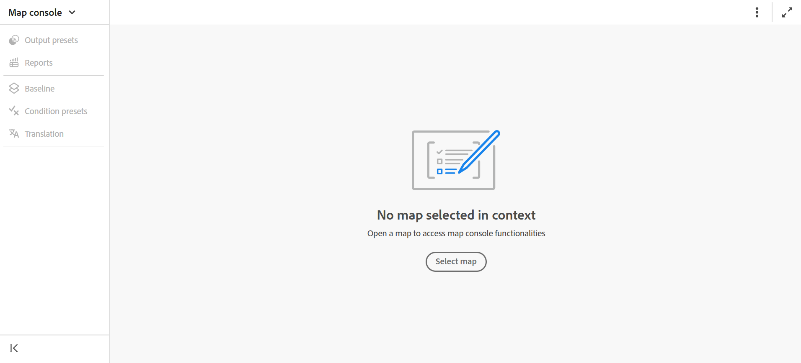

# Ouvrir les fichiers dans la console Map

Effectuez les étapes suivantes pour ouvrir un fichier DITA map dans la console Map :

1. Ouvrez la **console Map** à partir de la page d’accueil.

   {width="800"}

2. Puisqu’aucun fichier de mappage n’est sélectionné, vous êtes invité à sélectionner un fichier de mappage pour utiliser les fonctionnalités de gestion et de publication des mappages.

   

3. Choisissez **Sélectionner un mappage**, puis sélectionnez un chemin d&#39;accès où se trouve votre fichier de mappage DITA.

   Le fichier de mappage s’ouvre dans la console Mappage . Par défaut, l’onglet **Paramètres prédéfinis de sortie** est sélectionné.

   {width="800"}

   >[!NOTE]
   >
   >  La carte ouverte dans la console Carte est synchronisée avec la vue Carte disponible dans l’éditeur.

## Ouvrir les fichiers de mappage à partir de l’éditeur

Vous pouvez également ouvrir un fichier de mappage existant dans la console Mappage à partir de l’éditeur.

1. Accédez au fichier de mappage DITA et sélectionnez-le dans la vue Référentiel.

   Le fichier de mappage s’ouvre dans la vue Carte.

2. Sélectionnez l’icône **Ouvrir dans la console de mappage**.

   Le fichier de mappage s’ouvre dans la console Mappage .

   
