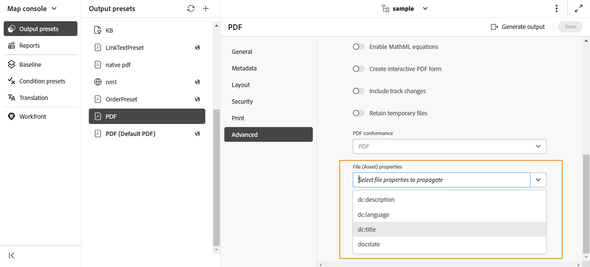
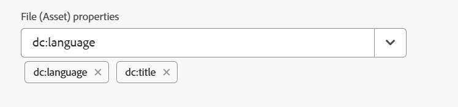
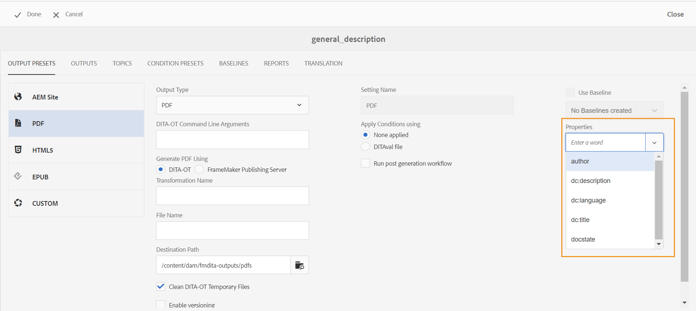
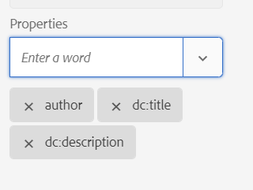

# Transmettre les métadonnées à la sortie à l’aide de DITA-OT {#id21BJ00QD0XA}

Les métadonnées sont des informations supplémentaires sur la sortie. Dans Adobe Experience Manager Guides, vous pouvez transmettre les métadonnées existantes ou créer des balises de métadonnées personnalisées. Vous pouvez transmettre des métadonnées à des sorties AEM, PDF, HTML5, EPUB et au format personnalisé à l’aide de la publication DITA-OT.

Il existe deux manières de transmettre les métadonnées à Output à l’aide de DITA-OT :

- [Utilisation de la console Carte](#using-map-console)
- [Utilisation du tableau de bord des cartes](#using-map-dashboard)

## Utilisation de la console Carte

Effectuez les étapes suivantes pour transmettre les métadonnées à la sortie à l’aide de la publication DITA-OT :

1. [Ouvrez le fichier de mappage DITA dans la console de mappage](./open-files-map-console.md) pour lequel vous souhaitez transmettre les métadonnées au DITA-OT.
1. Sélectionnez et ouvrez un paramètre prédéfini de sortie auquel vous souhaitez transmettre les champs de métadonnées. Par exemple, sélectionnez le paramètre prédéfini de sortie PDF. Assurez-vous qu&#39;il est créé à l&#39;aide de l&#39;option **DITA-OT**.
1. Dans la liste déroulante **Propriétés du fichier**, sélectionnez les métadonnées que vous souhaitez transmettre à la publication DITA-OT.

   

   La liste déroulante Propriétés répertorie les propriétés personnalisées et par défaut. Par exemple, dans la capture d’écran ci-dessus, `dc:description`, `dc:language`, `dc:title` et `docstate` sont les propriétés par défaut.

   >[!NOTE]
   >
   > Ces propriétés sont sélectionnées à partir du fichier metadataList disponible à l&#39;emplacement suivant : `/libs/fmdita/config/metadataList`. Par défaut, ce fichier contient quatre propriétés : `dc:description`, `dc:language`, `dc:title` et `docstate`.

   Ce fichier peut être recouvert à l’emplacement suivant : `/apps/fmdita/config/metadataList`.

   Pour transmettre une propriété personnalisée pour laquelle vous avez déjà défini les valeurs, affichez [Utiliser les métadonnées AEM dans la sortie PDF DITA-OT](https://experienceleaguecommunities.adobe.com/t5/xml-documentation-discussions/use-aem-metadata-in-dita-ot-pdf-output/td-p/411880).

1. Les propriétés sélectionnées sont répertoriées sous la liste déroulante.

   {width="300"}

1. Sélectionnez **Enregistrer** en haut à droite pour enregistrer les modifications.
1. Sélectionnez **Générer la sortie**.

Les propriétés de métadonnées sélectionnées seront transmises à la sortie générée à l&#39;aide de DITA-OT.

>[!NOTE]
>
> Depuis la version 2502 de Experience Manager Guides, la fonctionnalité permettant de transmettre des arguments de métadonnées de carte racine via la ligne de commande DITA-OT est obsolète. Toutefois, afin d’éviter toute perturbation, une nouvelle propriété a été ajoutée dans le `Config.Manager` pour activer ou désactiver la fonctionnalité.  Pour plus de détails, consultez [Configurer les paramètres de génération de sortie](../cs-install-guide/conf-output-generation.md#configure-the-dita-ot-command-line-arguement-field-on-the-dita-map-dashboard).

## Utilisation du tableau de bord des cartes

>[!NOTE]
>
>À compter de la version 2027.01.0 de Cloud Service et de la version 5.4 d’On-Premise de Experience Manager Guides , la fonctionnalité de tableau de bord des cartes sera abandonnée pour les nouveaux clients. Toutefois, elle restera activée pour les clients qui l’utilisent déjà. Si vous souhaitez désactiver le tableau de bord des cartes, contactez votre équipe du succès client. Il est dorénavant recommandé d’utiliser la console Map pour la gestion et la publication des cartes.

Si vous travaillez sur l’**interface utilisateur d’Assets**, procédez comme suit pour transmettre les métadonnées à la sortie à l’aide de la publication DITA-OT :

1. Dans l’**interface utilisateur d’Assets**, accédez au fichier de mappage DITA pour lequel vous souhaitez transmettre les métadonnées au DITA-OT et sélectionnez-le.
1. Sélectionnez et modifiez un paramètre prédéfini de sortie auquel vous souhaitez transmettre les champs de métadonnées. Par exemple, sélectionnez le paramètre prédéfini de sortie PDF.
1. Sélectionnez l&#39;option **DITA-OT** dans le paramètre prédéfini de sortie sélectionné.

   

1. Dans la liste déroulante Propriétés , sélectionnez les métadonnées que vous souhaitez transmettre à la publication DITA-OT.

   La liste déroulante Propriétés répertorie les propriétés personnalisées et par défaut. Par exemple, dans la capture d’écran ci-dessus, l’auteur est la propriété personnalisée tandis que `dc:description`, `dc:language`, `dc:title` et `docstate` sont les propriétés par défaut.

   >[!NOTE]
   >
   > Ces propriétés sont sélectionnées à partir du fichier metadataList disponible à l&#39;emplacement suivant : `/libs/fmdita/config/metadataList`. Par défaut, ce fichier contient quatre propriétés : `dc:description`, `dc:language`, `dc:title` et `docstate`.

   Ce fichier peut être recouvert à l’emplacement suivant : `/apps/fmdita/config/metadataList`.

   Pour transmettre une propriété personnalisée pour laquelle vous avez déjà défini les valeurs, affichez [Utiliser les métadonnées AEM dans la sortie PDF DITA-OT](https://experienceleaguecommunities.adobe.com/t5/xml-documentation-discussions/use-aem-metadata-in-dita-ot-pdf-output/td-p/411880).

1. Dans la liste déroulante **Propriétés**, sélectionnez les propriétés personnalisées et par défaut requises. Par exemple, sélectionnez `author`, `dc:title` et `dc:description`. Il s’agit de la valeur `metadata/properties` standard qui est créée une fois le fichier créé. Les propriétés sélectionnées sont répertoriées sous la liste déroulante.

   {width="300"}

1. Sélectionnez **Terminé** en haut à gauche pour enregistrer les modifications.
1. Générez la sortie.

Les propriétés de métadonnées sélectionnées seront transmises à la sortie générée à l&#39;aide de DITA-OT.

**Rubrique parente :**&#x200B;[&#x200B; Génération de sortie](generate-output.md)
