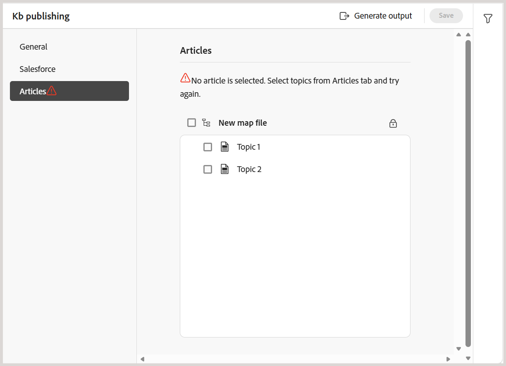
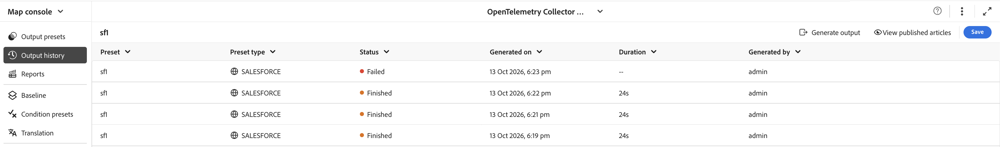

# Générer une sortie de la base de connaissances {#id218CL05J0M1}

Adobe Experience Manager Guides s’accompagne d’une fonctionnalité de publication d’articles qui permet aux utilisateurs de publier simultanément un ou plusieurs articles de la base de connaissances.

Ce moteur est également fourni avec un modèle de contenu prêt à l’emploi, qui repose sur les composants principaux de Adobe Experience Manager, et qui permet aux utilisateurs et aux utilisatrices de créer un référentiel de contenu technique basé sur les connaissances. Ce modèle peut être personnalisé en fonction des besoins des clients.Ce moteur permet aux utilisateurs de créer le plan DITA de manière additive et de publier des rubriques au fur et à mesure qu&#39;elles sont prêtes.

Si vous n&#39;avez mis à jour le contenu que pour quelques rubriques de votre plan DITA, il n&#39;est pas toujours nécessaire de publier le plan entier. Vous pouvez sélectionner et publier uniquement les rubriques mises à jour.

Pour la publication d&#39;articles, vous devez créer le paramètre prédéfini de sortie de votre plan DITA de la base de connaissances. Votre carte doit inclure les rubriques que vous souhaitez publier. Vous pouvez également appliquer des conditions et spécifier les détails AEM Sites pour le paramètre prédéfini de sortie. Vous pouvez ensuite générer une sortie à l’aide de la fonction **Générer la sortie**.

Effectuez les étapes suivantes pour générer une sortie basée sur un article :

1. [Créez le paramètre prédéfini de la base de connaissances](./generate-output-knowledge-base.md) pour une sortie basée sur des articles.
1. Accédez à l’onglet **Articles** et sélectionnez les rubriques pour lesquelles vous souhaitez générer la sortie.

   

   >[!NOTE]
   >
   > Lors de la publication sur Salesforce, une icône d’avertissement s’affiche en regard de l’onglet **Articles** si aucune rubrique n’est sélectionnée pour la publication. L’icône d’avertissement disparaît une fois que vous avez sélectionné une ou plusieurs rubriques.
1. Sélectionnez **Générer la sortie** en haut pour générer la sortie.
1. Dans l’invite **Confirmer les fichiers à publier**, sélectionnez les fichiers à publier et confirmez en sélectionnant **Publier**.

   

   Vous verrez l’état du processus de génération de sortie. La colonne **Rubriques** répertorie les rubriques pour lesquelles une sortie est générée tandis que la colonne **Statut** affiche le statut de publication de chaque rubrique.

   

   Pour afficher la sortie, fermez la boîte de dialogue **Sortie générée** et sélectionnez **Afficher la sortie** sur la page du paramètre prédéfini.

   >[!NOTE]
   >
   > Vous pouvez également Renommer, Dupliquer ou Supprimer un paramètre prédéfini de sortie existant à partir du menu Options.

## Publication Salesforce améliorée à l’aide du traitement principal

À compter de la version 2026.11.0 de Experience Manager Guides as a Cloud Service, une expérience de publication Salesforce améliorée est disponible. Il utilise le traitement principal pour prendre en charge des tâches de publication plus volumineuses, améliorer la sécurité et résoudre les problèmes liés au processus de publication existant.

>[!NOTE]
>
> L’expérience de publication Salesforce améliorée est désactivée par défaut. Pour l’activer, contactez l’équipe du succès client d’Adobe.

Lorsque vous publiez des articles dans Salesforce à l’aide de l’expérience améliorée, les fonctionnalités supplémentaires suivantes sont disponibles :

- **Avertissement pour les rubriques non sélectionnées** : un indicateur d’avertissement s’affiche dans l’onglet **Articles** du paramètre prédéfini de sortie de la base de connaissances Salesforce lorsqu’aucune rubrique n’est sélectionnée pour publication. L&#39;avertissement disparaît une fois que vous avez sélectionné une ou plusieurs rubriques.

  
- **Statut de publication au niveau de l’article** : après la génération de la sortie, le statut de publication de chaque article, tel que Succès ou Échec, ainsi que son sujet ou son nom de fichier s’affichent dans la boîte de dialogue **Résultats de la publication Saleforce**.

  

- **Journaux de publication** : utilisez l’option **Afficher le journal** dans le paramètre prédéfini de sortie de la base de connaissances Salesforce pour consulter les journaux de publication et résoudre les erreurs ou les avertissements.

  

  Les journaux fournissent également un résumé des résultats de publication.

  
- **Historique de sortie** : affichez l’historique de sortie des tâches de publication à partir de la **console Mappage** ou de l’interface utilisateur d’Assets **&#x200B;**.

  Pour plus d’informations sur la gestion des tâches de publication, consultez [Gérer le processus de génération de sortie](./generate-output-manage-process.md).

  
- **Publication de ressources optimisée :** lors de la publication de rubriques dans Salesforce, Experience Manager Guides vérifie que les ressources référencées, telles que les fichiers multimédias et autres fichiers non DITA, ont été modifiées depuis leur dernière publication. Seules les ressources modifiées sont publiées à nouveau, tandis que les ressources inchangées sont ignorées. Cela réduit les mises à jour de ressources redondantes et améliore l’efficacité de la publication.

### PKCE et actualisation de l’authentification basée sur les jetons

L’expérience de publication Salesforce améliorée prend également en charge l’authentification par jeton d’actualisation, ce qui réduit la nécessité de se connecter à plusieurs reprises à Salesforce à partir de Experience Manager Guides lorsque les jetons d’accès expirent.

>[!NOTE]
>
> La prise en charge du jeton d’actualisation est désactivée par défaut. Pour l’activer, contactez l’équipe du succès client d’Adobe.

Pour utiliser cette fonctionnalité, assurez-vous que **l’exécution de requêtes à tout moment (refresh_token, offline_access)** est incluse dans les portées OAuth sélectionnées et que **l’extension Require Proof Key for Code Exchange (PKCE) Extension for Supported Authorization Flows** est activée dans votre application connectée Salesforce.

L’activation de la prise en charge des jetons d’actualisation dans Experience Manager Guides active automatiquement la prise en charge PKCE. Cependant, le paramètre correspondant doit également être activé dans Salesforce pour que l’authentification fonctionne correctement.

**Rubrique parente :**&#x200B;[&#x200B; Utiliser l’éditeur](web-editor.md)
