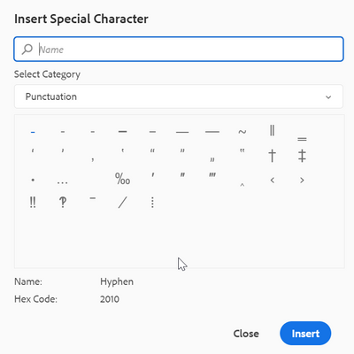
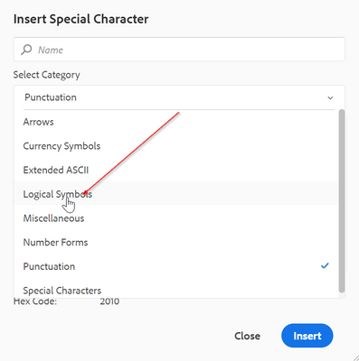
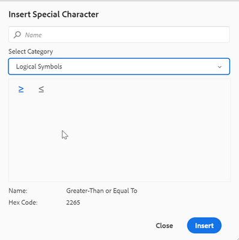

# Comment configurer des caractères spéciaux supplémentaires dans la barre d’outils de l’éditeur pour On-Premise

Il existe une option de raccourci dans la barre d’outils de l’éditeur web pour permettre à l’auteur d’insérer déjà les caractères spéciaux.
Vous pouvez voir la même chose dans la capture d’écran ci-dessous :




Cette liste de caractères peut être configurée ici. Si vous devez y ajouter d’autres caractères, procédez comme suit :

+ Connectez-vous à AEM et ouvrez le mode CRXDE Lite .

+ Créez le fichier symbols.json à l’emplacement suivant : &#39;/apps/fmdita/xmleditor/&#39; (Vous pouvez copier le fichier par défaut depuis - &#39;/libs/fmdita/clientlibs/clientlibs/xmleditor/symbols.json&#39; location)

+ Ajoutez la définition de caractères spéciaux dans le fichier symbols.json en tant que :

```
{
      "label": "Logical Symbols",
      "items": [
        {
          "name": "≥",
          "title": "Greater-Than or Equal To"
        },
        {
          "name": "≤",
          "title": "Smaller-Than or Equal To"
        }
      ]
}
```

La structure du fichier symbols.json est expliquée ci-dessous :

+ « label » : « Symboles logiques » : permet de spécifier la catégorie des caractères spéciaux. Dans le fragment de code, une catégorie portant le nom « Symbole logique » est définie.

+ « items » : définit l&#39;ensemble des caractères spéciaux de la catégorie.

+ « name »: « ≥ », « title »: « Greater-Than or Equal To »: C&#39;est la définition du caractère spécial. Il commence par le libellé « nom », qui ne doit pas être modifié. Le nom est suivi du caractère spécial. Le « titre » est le nom ou le titre du caractère spécial qui s’affiche en tant qu’info-bulle pour ce caractère spécial.

Vous pouvez définir plusieurs définitions de caractères spéciaux au sein d’une catégorie.

Vous ajouterez ainsi une autre catégorie dans la boîte de dialogue des caractères spéciaux :





>[!MORELIKETHIS]
>
>+ [ Guide d’installation et de configuration ](https://helpx.adobe.com/content/dam/help/en/xml-documentation-solution/3-6/XML-Documentation-for-Adobe-Experience-Manager_Installation-Configuration-Guide_EN.pdf)
